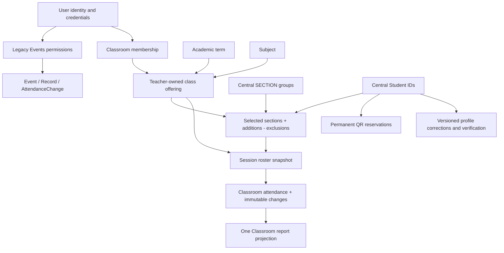

# Dedicated Classroom Attendance & Teacher Module Implementation Plan

> **For agentic workers:** After this plan is approved, use `superpowers:executing-plans` to implement it task by task, or `superpowers:subagent-driven-development` if the user chooses delegation. Checkboxes track future work; none authorizes implementation now.

**Goal:** Give approved teachers a dependable, phone-first classroom attendance workspace on the deployed school platform while preserving Events, the shared student directory, and existing student QR codes.

**Architecture:** Extend the current Next.js application and PostgreSQL database with a separate Classroom domain. Reuse identity, authentication primitives, visual components, camera capture, and PostgreSQL guarded-write techniques; keep Classroom authorization, attendance state, snapshots, and reporting separate from Events.

**Tech stack:** Verified lockfile: Next.js 15.5.20, React 19.1.0, TypeScript 5.9.2, Prisma/client/adapter-pg 7.10.0, PostgreSQL, TanStack Query 5.87.1/Table 8.21.3, Zod 4.1.9, Tailwind 4.1.13, react-hook-form, Radix/shadcn, `@yudiel/react-qr-scanner` 2.4.1, `react-qr-code` 2.0.21. Retain these versions for this feature unless a separately reviewed compatibility/security update is necessary.

**Spec:** The user's “Implementation Planning Goal: Dedicated Classroom Attendance & Teacher Module,” including scenarios A–H, is the controlling specification. This document captures its implementation decisions and acceptance mapping.

**Status:** Proposed for review. Repository inspection and this document are the only work performed. No application implementation, dependency installation, migrations, deployment, or production-data access is authorized by this document.

## Global Constraints

- One deployed platform, two focused workspaces: **Events** and **Class**. Workspace selection never authorizes access.
- Teachers are `User` accounts. Only the teacher application introduces an approval workflow; routine teaching and permitted student corrections require no further approval.
- Preserve separately held Events permissions when approving, rejecting, suspending, or revoking Class access.
- Reuse central `Student.id`, current section groups, and existing QR payloads. Never duplicate students for classes or teachers.
- Persist roster exceptions once per class. Freeze eligibility, student labels, and policy for each attendance session.
- Classroom outcomes: Unmarked while active; Present, Late, Absent, Excused. No time-out, toggling, faculty attendance, or student self-check-in.
- All school dates and display times use `Asia/Manila`. Store instants as PostgreSQL `timestamptz(3)`.
- Default attendance pagination: **100 students**; touch actions at least **48 × 48 CSS px**; validate at **375 px** width.
- The teacher uses the deployed HTTPS website. No development environment, local server, build, start command, or LAN setup appears in teacher instructions.
- Use Conventional Commit subjects; include a concise body where motivation and behavior need explanation.

## Review Focus

1. Lost HTTP acknowledgement after commit: retrying the same command must recover the original receipt, including after finalization (T2, T8, T9).
2. External identifier becomes available after correction/deletion: the old QR must never resolve to a different person (T4).
3. Teacher suspension races a scan or profile correction: writes linearize before suspension or fail after it, independently of Events access (T1, T2, T4, T8).
4. Section transfer or import races session creation: the snapshot represents one coherent roster, and past reports remain unchanged (T4, T5, T7).
5. A filtered student's row disappears after marking: retain the scroll anchor, filter, and search, and show confirmed feedback (T9).

---

## 1. Executive Summary

Build Class as a dedicated teacher workspace in the existing application. A teacher signs in, obtains one administrator approval, sets up a subject offering with one or more sections, reviews saved irregular additions/exclusions, and then follows **Open class → Start attendance** on subsequent visits. A teacher scans students' existing QR codes with a phone or uses an equally capable manual roster. Unmarked students become absent only on explicit finalization.

The principal decisions are:

1. Introduce an independent `ClassroomMembership`; do not add an exclusive `TEACHER` role.
2. Separate account usability from legacy organizer approval, and close every existing API/print access path before admitting teacher-only accounts.
3. Model classes as subject offerings within terms, with selected sections and persistent student exceptions; sessions own historical roster/policy snapshots.
4. Add a permanent QR-code reservation registry before enabling identifier corrections. Ambiguous, retired, or reassigned values must fail closed.
5. Use short, locked PostgreSQL transactions, composite uniqueness, optimistic revisions, and durable command receipts. Client debounce is only a usability optimization.
6. Ship onboarding, manual fallback, audit/monitoring, and consistent reports as release requirements.
7. Release without offline queueing. A disconnected or uncertain save remains visibly unconfirmed until a server receipt is recovered.

**Scope:** teacher applications, workspace navigation, terms/subjects/classes, roster configuration, classroom sessions, scanning/manual attendance, individual student corrections/verification, reports, admin assistance and monitoring, migration/testing/release documentation.

**Non-goals:** LMS coursework, grades, payroll/faculty attendance, classroom QR generation for students to scan, time-out, calendar automation, separate student identities, offline synchronization, school-wide multi-tenancy, co-teacher UI, merging `library-mvp`, or changing existing Events attendance policy/history semantics.

**Approach assessment:** Reusing `Event`/`Record` directly would import approval, current-audience eligibility, and timeout semantics into classes. A separate deployed application would duplicate authentication, student identity, and operating costs. The recommended additive Classroom domain in this application provides separation while reusing the right foundations. This is a recommendation for plan approval, not a choice already approved by the user.

## 2. Repository Findings

### 2.1 Inspected state and limits

- Inspection date: **2026-11-02**, school timezone Asia/Manila.
- Local branch `main`, clean before this planning document; local HEAD and `git ls-remote origin refs/heads/main` both returned **`3135d3204c71c960fd6dfb2bef765a8a87a1f171`**. No assumption that the supplied baseline was current was needed.
- Local and remote `library-mvp`: **`cc516c61adf7206ea96d7eb2ff64d4f5f853bb5d`**. Read with `git show`/`git diff`; no checkout, merge, or cherry-pick.
- Versions above come from `package.json` and `pnpm-lock.yaml`, not the older architecture tables.
- No live deployment configuration, database contents, production query plans, or device tests were inspected. PostgreSQL 17 appears in documentation; actual hosted server version remains a release verification item.
- This is source inspection, not a full security scan or a claim that existing tests pass.

### 2.2 Actual integration points

| Area | Current source and behavior | Plan implication |
|---|---|---|
| Database | `prisma/schema.prisma`: `Event`, `Record`, `AttendanceChange`, `Student`, `Group`, `User`, import receipts, custom membership. PostgreSQL datasource; existing dates have `Timestamptz(3)`. | Add Classroom tables; do not repurpose Events rows. |
| Migrations | Six active PostgreSQL migrations from `20260926075853_init_postgres_baseline` through `20261023000300_custom_groups`; SQLite history is archived. | Append migrations; never rewrite baseline or replay SQLite migrations. |
| Student identity | `Student.id` is generated for new students; legacy IDs can be 11-digit numbers. `usn`/`lrn` are separate nullable unique strings. `globals/utils/studentIdentity.ts` resolves the union of id/USN/LRN and rejects multiple people. | Keep IDs stable; preserve leading zeroes and reject cross-namespace ambiguity. |
| QR creation | `features/students/utils/qrIdentifier.ts`, `StudentQRCard.tsx`: prefer USN, allow LRN, fall back to internal ID. | All three payload types need compatibility; do not assume cards contain only internal IDs. |
| Student edit | `globals/utils/studentEdit.ts` uses global roster exclusive lock and content-hash `expectedVersion`; revalidates merged schema. Principal recheck currently checks only status. Academic groups are replaced as a set. | Reuse concurrency contract; strengthen authorization, audit, identifier reservations, and preserve unrelated group relations. |
| Student operations | `/api/students` POST, `/api/students/[id]` DELETE, `/api/students/bulk/{preview,commit}`, and selected export currently use broad `requireAuth`. Event student history also accepts any active user. | Do not make generic active authentication mean teacher directory or destructive access. Explicit endpoint capability audit is launch-blocking. |
| Imports | `/api/students/imports/*` are admin-gated; legacy `/api/bulk-import/students` is admin-gated. `features/students/import/writeBatches.ts` performs raw SQL scalar and join-table writes. | Protect existing gates and integrate registry/version/audit into raw writers, not just single-record PATCH. |
| Authentication | `globals/utils/auth.ts`: signed HttpOnly seven-day cookie, fresh DB checks, credential generation and forced password gate. `User.role` is ADMIN/ORGANIZER; `User.status` is organizer approval. Login refuses pending/rejected users before issuing a cookie. | Add identity-only sessions for application status and independent memberships. Preserve credential revocation and safe cookie flags. |
| Admin review | `/api/admin/organizers/[organizerId]`: sorted user-row locks, in-transaction admin recheck, pending precondition. | Reuse review pattern, but approve a Classroom membership rather than legacy user status. |
| Shell | `app/(main)/layout.tsx` is a client gate with organizer wording. Login and AuthContext route to `/dashboard`. Sidebar/mobile navigation hardcode Events routes. | Add server authorization plus a separate `/class` shell and capability-aware destination resolver. |
| Attendance | `features/attendance/server/recordAttendance.ts`: User SHARE lock, shared roster advisory lock, Event SHARE lock, pair lock, unique event/student, server clock, immutable event changes; conditional updates and bounded retry. | Reuse protocol style, not event attendance state machine or service. |
| Camera | `ScannerCamera.tsx`: dynamic camera consumption, pending pause, scan gate, local `/qr-decoder/` WASM lookup. Coordinator validates server acknowledgement and distinguishes unknown outcomes. | Extract capture-only reusable code carefully; use a Classroom coordinator without TIME_IN/TIME_OUT types. |
| Reporting | `globals/utils/eventReport.ts` already shares authorized RepeatableRead loading and report building with API/export/print. Actual print page is `app/(print)/reports/events/[id]/print/page.tsx`. | Reuse the single-loader/pure-projector pattern and print layout; separate Classroom formulas and snapshot inputs. |
| Time/export | `globals/utils/reportTime.ts`, `csvExport.ts`, `features/reports/utils/eventExport.ts`, print components. | Reuse timezone formatting and CSV safety; do not reuse Events turnout denominator. |
| UI | Poppins/indigo, `designTokens`, `PageHeader`, `StatusBadge`, `Sheet`, forms, `useConfirm`, shared table states, toasts. | Extend this design system with teacher roster cards and Classroom states. |
| Tests/operations | Node test runner + tsx, disposable PostgreSQL helper `scripts/pg-test-db.mjs`, Python Playwright attendance harness, backup CLI and runbooks. No universal `test` script or root `tests/` directory. | Extend real test infrastructure; do not assume Jest/Vitest or install a competing stack by default. |

### 2.3 Source risks and documentation discrepancies

- Broad `requireAuth()` guards would leak Events/whole-directory actions if changed to accept every approved teacher. Preserve its legacy business-route meaning until all callers have explicit capabilities; introduce identity/Class guards separately.
- `studentEdit.ts` has no immutable profile before/after ledger or version-bound verification model. Its status-only in-transaction recheck cannot establish independent Class entitlement.
- Identifier uniqueness today is per column. The resolver detects cross-namespace collisions, but database indexes alone cannot prevent a corrected/reused value from identifying another student later. No historical alias registry exists.
- Some writers replace `_GroupToStudent` through raw SQL or `groups.set`. Preserve custom memberships and any unrelated categories; explicitly control which academic categories an edit owns. Students with ambiguous existing academic groups require a visible repair flow, not silent normalization.
- `globals/libs/prisma.ts` gives imports generous global transaction defaults (120-second timeout/30-second wait). Classroom interactive operations must override them with short budgets.
- Current Events reports/history intentionally use current eligibility in several places. That must not be copied into Classroom or retroactively changed as part of this work.
- Older `docs/architecture.md`, `domain-model.md`, `conventions.md`, and audit release notes contain LAN assumptions, obsolete student structures, console-only attendance audit claims, incomplete migration counts, and obsolete report/print descriptions. Current code already has event change history, PostgreSQL backups, credential gates, and a shared print loader.
- `docs/testing/attendance-e2e.md` describes “no internet” while LAN/database remain available. That is not proof of deployed mobile internet reliability or offline support.
- Signup/rate-limit comments assume one process/LAN; verify trusted proxy handling and shared rate limiting against the actual deployment before a public teacher rollout.

### 2.4 `library-mvp`: ideas to retain and exclude

`features/library/server.ts` demonstrates UUID request normalization, transaction-scoped command locks, durable request replay, post-lock server time, actor revalidation, and RepeatableRead history. Its tests include simultaneous clients and UUID case variants. Adapt these techniques with actor-scoped keys and a hash of the entire command.

Do not copy `LibraryVisit`, employee registration through Student, cooldown-driven visit toggling, departure/forgotten-visit closing, demonstration data, branch schema changes, or deployment assumptions. Existing `AttendanceChange` and `StudentImportBatch` on main also provide durable receipt/hash patterns; a branch merge is unnecessary.

## 3. Proposed Domain Architecture

### 3.1 Identity versus workspace permission

Keep existing `User.role`/`status` as legacy Events authorization fields, with a documented transition boundary:

- Add base `UserRole.MEMBER` for an identity with no Events grant. This is not a teacher role: Class access comes exclusively from membership. A dual user remains ORGANIZER plus approved membership.
- Add `User.accountState = ENABLED | DISABLED` as the global credential/account kill switch. Backfill all existing accounts ENABLED; pending/rejected organizer status remains a denial of Events, not an accidental global denial.
- New Class applicants: MEMBER, legacy status PENDING, accountState ENABLED, Classroom membership PENDING. Correct credentials can create a restricted identity session to view/apply for access. They cannot read students or classes.
- Existing organizers may apply using the same User. Never create another account for their email. Their Events status and role remain unchanged.
- A MEMBER later requesting Events changes to ORGANIZER/PENDING through the existing organizer application flow; Class membership is untouched. Existing rejected organizers can still be approved for Class.
- `requireIdentity()` checks cookie, current credentialVersion, accountState and forced-password policy. `requireEventsAccess()` additionally requires ACTIVE legacy status and ORGANIZER/ADMIN. `requireClassroomAccess()` additionally requires APPROVED membership or an active administrator. `requireAdmin()` requires enabled ACTIVE ADMIN and completed password replacement.
- Retain `requireAuth()` as a deprecated compatibility alias for `requireEventsAccess()` so undiscovered legacy callers fail closed for teacher-only identities. Migrate callers explicitly; never silently broaden it.
- Update credential replacement/recovery logic that currently requires `User.status === ACTIVE`: own-password replacement must work for enabled identity-only applicants while remaining credential-version guarded. Every protected business operation still denies a forced-password session.
- Session DTO exposes computed workspace capabilities and membership status; cookie claims are identity hints, never durable authority. Logout clears all user-scoped caches. No credentials/hashes are serialized.

Approval is PENDING → APPROVED or REJECTED. Approved access can be SUSPENDED or REVOKED with a reason. Restoration is an audited admin state change, not a new routine-operations approval queue. Rejected applicants can edit and resubmit their own application. Suspended/revoked users see status/help, not a resubmit bypass.

### 3.2 Classes and roster composition

- `AcademicTerm`: school-wide reference term, dates, timezone and archived state. Teachers can select existing terms or create a missing term inline with validation and audit; no approval. Duplicate normalized keys return the existing candidate for selection. Admins maintain shared term metadata; teacher changes are confined to their class selection.
- `Subject`: school-wide catalog identity, optional normalized code and required title. Teachers select or enter a subject; inline creation is immediately usable. Teachers cannot rename another class's shared subject. A teacher edits their class display title instead; admins correct shared catalog metadata.
- `ClassOffering`: term, subject, primary teacher, display name (e.g. “Programming 2 — Class A”), optional schedule, default grace policy, version and archive state. No unique subject/term or section/subject constraint: multiple offerings are legitimate.
- `ClassSection`: selected existing `Group` rows of category SECTION only. Selection does not alter any official student membership.
- `ClassRosterException`: one row per class/student, INCLUDE or EXCLUDE. The exclusion overrides section inclusion. A PUT replaces sections/exceptions atomically with an expected roster revision.
- Live roster is `distinct((section members ∪ INCLUDE students) − EXCLUDE students)` by Student.id. Show provenance and ambiguity warnings. Employees/reserved employee membership are not eligible student entries.
- Section memberships stay in the existing shared directory. Live roster recomputes for future sessions; section transfer is effective at the next snapshot, not retroactively. Review UI explains that official-section corrections can affect other classes' future rosters and existing Events eligibility.
- Primary teacher ownership is sufficient for v1. All permission checks call `canManageClass` rather than duplicating `teacherId` comparisons. A later explicit `ClassTeachingAssignment` join can add co-teachers while retaining primaryTeacherId and audit; no co-teacher permissions exist in v1.
- Teachers archive their own classes; administrators can create, transfer ownership, configure, and correct on their behalf with audit/reason. Archive blocks starting new meetings, preserves reports, and does not silently cancel an active session. No hard deletion of teaching history.

### 3.3 Historical sessions and attendance

- No persisted Draft session is necessary in v1. Preparing a class/start form creates no attendance and no absences.
- Start creates an ACTIVE `ClassroomSession`, section/class/policy snapshots, one eligible `SessionRosterMember` per student, and exactly one UNMARKED `ClassroomAttendance` row per member in one transaction.
- Freeze subject/class/teacher/term labels, section labels, student names/USN/LRN/internal ID, provenance, start instant, timezone, grace period, late threshold, and roster/config revisions. Current directory labels may be shown separately; historical labels remain authoritative for reports.
- Allow only one ACTIVE session per class, enforced by a partial unique index. Multiple finalized/canceled meetings on the same local date are allowed. A fresh start while active returns the existing session for Continue; it never creates a second one.
- ACTIVE → FINALIZED atomically changes remaining eligible UNMARKED rows to ABSENT and appends audit changes. ACTIVE → CANCELED creates no absences. FINALIZED → CANCELED is permitted with explicit reason for a mistaken meeting; retain all records/audits and exclude it from rates. No reopen or delete route in v1.
- Finalized corrections require a reason and expected row revision; they do not reopen the session or recompute every student's outcome.
- A session roster adjustment is explicit, reasoned and audited. Do not rewrite original snapshot fields. Add a new member or mark an existing member ineligible with removedAt/reason, retaining prior attendance and immutable before/after audit. Reports exclude ineligible members and show adjustment context. Finalized inclusion requires an explicit final outcome; finalized sessions never gain UNMARKED rows.

### 3.4 Lateness and reporting convention

Class default grace: **15 minutes**, configurable integer 0–180. Schedule is optional and supplies a suggested start only. At each Start dialog choose meeting date/start time, defaulting to the configured local schedule or server-provided “now”; show/edit this before starting. Reject an ambiguous timestamp without timezone and future starts more than five minutes ahead. Historical manual sessions can use a past start inside the term, with a visible warning; scans still use current server time.

`lateAfter = scheduledStartAt + graceMinutes`. Scans acknowledged at or before lateAfter are PRESENT; scans strictly after are LATE. Use server time sampled after required locks, never client capture time. A retry replays its original time/status even if the threshold has since passed. Grace/start/lateAfter are immutable session policy; fixing a mistaken policy is an audited explicit session policy amendment, never automatic reclassification of existing marks. Require explicit student corrections for changed outcomes.

Manual initial Present and Late are explicit statuses; suggest late based on the policy but let the teacher decide. Any change to an existing marked outcome requires a reason. Excuse note is optional and separate from the required reason for a correction; no excuse-letter uploads in v1.

Only eligible members of FINALIZED sessions contribute to official attendance rates:

`numerator = Present + Late; denominator = Present + Late + Absent; rate = denominator === 0 ? null : numerator / denominator`.

Present and Late counts are disjoint; “Attended” is their sum. Excused is counted separately and excluded from denominator. Active sessions show provisional counts including Unmarked, never inferred absences. Canceled sessions and not-enrolled members never enter the denominator. Term/class rates use summed counts, not averages of student/session percentages. Display one decimal percent, retain integer numerator/denominator, and render null as N/A. Label this **System reporting convention v1**, not official school policy.

## 4. Database Design

### 4.1 Proposed Prisma model contract

The following is the schema blueprint, not a migration to run. Implement inverse Prisma relations explicitly in T1/T4/T5/T7. IDs are cuid strings unless specified; instants use `@db.Timestamptz(3)`, school dates `@db.Date`, structured audit JSON `@db.JsonB`. Mutable entities have createdAt/updatedAt. Actor IDs in immutable logs are scalar snapshots, so account changes cannot erase attribution.

| Model / existing addition | Required fields and relationships | Constraints and indexes |
|---|---|---|
| `User` additions | `accountState` default ENABLED; role enum adds MEMBER; optional one-to-one ClassroomMembership, TeacherOnboarding; primaryClasses relation | Existing email uniqueness retained; index accountState. No rewrite of role/status or existing event FKs. |
| `ClassroomMembership` | `userId` PK/FK User RESTRICT; status PENDING/APPROVED/REJECTED/SUSPENDED/REVOKED; departmentOrDesignation ≤160; optional staffReference ≤100; applicationText ≤1000; appliedAt/reviewedAt; reviewer ID/name snapshots; decisionReason ≤1000; revision Int default 0 | index(status, appliedAt, userId); one current membership per User. Full application/state history in ClassroomAudit. |
| `TeacherOnboarding` | userId PK/FK User RESTRICT; flowVersion Int default 1; step enum; draft JSON limited to 16 KiB; classId nullable FK ClassOffering RESTRICT (added in M3); completedAt nullable; revision | M1 creates progress without classId; M3 adds its column/FK after ClassOffering exists. Progress references saved domain entities, not a second unsaved roster database. |
| `AcademicTerm` | id; name ≤100; normalizedKey; startDate/endDate; timeZone default Asia/Manila; archivedAt; createdById scalar; revision Int default 0 | unique(normalizedKey); check endDate >= startDate; index(startDate,endDate). normalizedKey is trimmed/collapsed/lowercase name plus start/end ISO dates; never auto-create real terms from Event dates. |
| `Subject` | id; code nullable ≤40; normalizedCode nullable; title ≤160; normalizedTitle; archivedAt; createdById scalar; revision Int default 0 | unique(normalizedCode); partial unique normalizedTitle WHERE code IS NULL, for duplicate-safe inline no-code creation; search index normalizedTitle. Normalize code to trimmed uppercase, title to collapsed lowercase for duplicate comparison; preserve display text. |
| `ClassOffering` | id; termId FK Term RESTRICT; subjectId FK Subject RESTRICT; primaryTeacherId FK User RESTRICT; displayName ≤160; schedule JSON version 1; graceMinutes 0–180; configRevision and rosterRevision Int default 0; archivedAt | index(primaryTeacherId,termId,archivedAt,id); index(termId,subjectId); no unique offering name/subject/section restriction. |
| `ClassSection` | classId FK ClassOffering RESTRICT; sectionId FK Group RESTRICT; createdAt | composite PK(classId,sectionId); index(sectionId,classId); category SECTION enforced in guarded service. |
| `ClassRosterException` | classId FK ClassOffering RESTRICT; studentId FK Student RESTRICT; kind INCLUDE/EXCLUDE; reason ≤1000; created/updatedBy scalar | composite PK(classId,studentId); index(studentId,classId); replacing INCLUDE with EXCLUDE cannot create competing rows. |
| `Student` additions | `profileRevision Int default 0`; optional archivedAt for future-safe retirement | Keep id/usn/lrn/legacy constraints; index(archivedAt,id) if used in live directory. Classroom references use RESTRICT. |
| `StudentQrCode` | `code String @id` ≤128; `reservedOwnerId String?` immutable scalar; `studentId String?` FK Student SET NULL; state RESOLVABLE/RETIRED/QUARANTINED; originalKind INTERNAL_ID/USN/LRN; createdAt; retiredAt nullable | One reservation across ALL raw QR namespaces, case-sensitive. index(studentId,state). Check resolvable requires nonnull owner/student and matching owner; retired/quarantined never resolve. Never delete/reassign reservation keys. |
| `StudentProfileChange` | BigInt autoincrement id; studentId FK Student RESTRICT; fromRevision/toRevision; before/after Json including academic group IDs/labels; actorId/name snapshots; source TEACHER/ADMIN/EVENTS/IMPORT/BULK; reason; commandId UUID; createdAt | unique(studentId,toRevision); index(studentId,id), index(actorId,createdAt,id). Immutable. New imported students get a baseline creation entry; migration makes a labeled baseline without inventing past edits. |
| `StudentVerification` | BigInt id; studentId FK Student RESTRICT; profileRevision; verifiedContentHash SHA-256; state VERIFIED/NEEDS_CORRECTION; note ≤1000 optional; actorId/name snapshots; commandId; createdAt | index(studentId,profileRevision,id); immutable assertions. Latest assertion matching CURRENT revision AND relevant content hash yields state; none means UNVERIFIED. Changes invalidate without deleting assertions. |
| `ClassroomSession` | id; classId FK ClassOffering RESTRICT; state ACTIVE/FINALIZED/CANCELED; scheduledStartAt; startedAt; finalizedAt/canceledAt nullable; timezone; graceMinutes; lateAfter; originalPolicySnapshot Json v1; classSnapshot Json v1; rosterConfigSnapshot Json v1; lifecycleRevision Int default 0; snapshotRevision Int default 0; started/finalized/canceled actor snapshots; cancellationReason | index(classId,scheduledStartAt,id); index(state,startedAt); partial unique(classId) WHERE state='ACTIVE'; checks for state timestamps, grace, lateAfter relation. No unique class/date. |
| `SessionRosterMember` | sessionId FK Session RESTRICT; studentId FK Student RESTRICT; studentSnapshot Json v1 (name/identifiers/section labels/profileRevision); originSnapshot Json v1; admittedAt; included Boolean default true; removedAt/reason; membershipRevision Int default 0 | composite PK(sessionId,studentId); index(studentId,sessionId), index(sessionId,included,studentId). No delete on removal. |
| `ClassroomAttendance` | sessionId/studentId composite FK to SessionRosterMember RESTRICT; status UNMARKED/PRESENT/LATE/ABSENT/EXCUSED; method nullable SCANNED/MANUAL/FINALIZATION; markedAt nullable; recordedById/name scalar; lastModifiedById/name scalar; excuseNote ≤1000 nullable; revision Int default 0 | composite PK(sessionId,studentId) guarantees one result and roster membership; index(sessionId,status,studentId). Marked rows require markedAt/method; UNMARKED has neither; only EXCUSED can hold excuseNote. |
| `ClassroomAttendanceChange` | BigInt id; sessionId/studentId composite FK SessionRosterMember RESTRICT; action MARK/CORRECT/FINALIZE_ABSENT; before/after Json; actorId/name snapshots; reason; commandId UUID; createdAt | index(sessionId,id), index(studentId,sessionId,id), index(actorId,createdAt,id); immutable. Attendance revision in before/after makes chains inspectable. |
| `ClassroomAudit` | BigInt id; action enum/string from server allowlist; entityType/id; optional classId/sessionId/studentId scalar context; actorId/name; before/after Json; reason; commandId UUID; createdAt | index(classId,id), index(sessionId,id), index(studentId,id), index(actorId,createdAt,id), index(action,createdAt,id). Covers applications, settings, rosters, ownership, snapshot changes, cancellations, exports, verification context and QR retirement. No mutable status fields. |
| `ClassroomCommandReceipt` | actorId scalar; commandId UUID; operation; resourceId; requestHash SHA-256; result Json v1; httpStatus; createdAt | composite PK(actorId,commandId); index(resourceId,createdAt); successful durable commands/no-op outcomes only, no partially committed receipts. Append-only. No v1 expiry/purge. |

Do not give new audit tables cascading delete relations. Add custom SQL CHECKs/partial indexes where Prisma schema notation cannot express them. Serialize BigInt audit IDs as decimal strings in HTTP, never JS numbers.

### 4.2 Immutable data enforcement

Use append-only INSERT/SELECT privileges for audit, verification and receipt tables under the runtime DB role; migration owner retains DDL rights. Add PostgreSQL triggers rejecting UPDATE/DELETE on these tables so immutability does not depend on route conventions. Add a registry trigger preventing code deletion and any change to a nonnull reservedOwnerId, and restricting state transitions: RESOLVABLE → RETIRED; QUARANTINED → RESOLVABLE only through an administrator repair with audit and proven ownership. A quarantined code with null owner can receive its one permanent owner only during that repair; a code already bound to one person can never be assigned to another. Retired codes remain reserved permanently; reactivation, if later required, is a separate reviewed feature.

Immutable snapshot fields likewise reject UPDATE after insertion; services may change only inclusion metadata/revisions and explicit session policy amendment fields. originalPolicySnapshot always preserves the initial scheduledStartAt/timezone/graceMinutes/lateAfter; effective policy columns can change only for an ACTIVE session with an audited amendment and lifecycleRevision increment. Existing marks are never recomputed. classSnapshot/original roster config/member identity snapshots are never overwritten. Runtime role cannot disable triggers. This is application/database immutability, not protection against a database superuser; protect backups and administrative credentials operationally.

Keep Student hard deletion admin-only and restricted whenever history, verification, roster references, or audit exist. For otherwise unused records, retire reservations and preserve reservedOwnerId tombstones before deletion. Offer retirement/archive for referenced students, preserving reports and stable IDs. No teacher identity merges/deletion or merge feature is introduced.

### 4.3 QR reservations and correction rules

1. Backfill the union of Student.id/usn/lrn using exact strings, trimming only outer whitespace according to current scanner behavior. Preserve case and zeroes; do not parse identifiers as numbers.
2. When a code belongs to only one student (including several identifier fields on the same student), reserve it for that ID. If it maps to multiple students, quarantine the code and retain candidate evidence in migration audit. Never choose a winner by query order. Manual marking remains available.
3. Shared `resolveStudentIdentity` checks the registry, including blocked values. It must not fall through to another namespace when a reservation is retired/quarantined. During staged backfill only, a controlled compatibility mode may union legacy and registry candidates and reject disagreement; enable registry authority only after completeness checks.
4. Single edits, creates, admin bulk operations, import classification/commit and raw SQL import writers all use reservation validation in the same transaction as student changes. Creating a new student also reserves its generated internal ID. Database current-identifier constraints remain as defense in depth. Add DEFERRABLE INITIALLY DEFERRED constraint triggers checking registry/current identifier consistency at commit, so a new Student can be inserted before its FK-backed reservations in the same transaction. Reserve new external values, update Student, and retire prior codes within one roster-exclusive boundary. Grandfathered quarantined current conflicts remain blocked from scanning, while new/changed identifier values must have unambiguous same-owner reservations; no edit/import can introduce a new claim to a quarantined or retired code. Test direct SQL bypass as well as application guards.
5. On an identifier edit, show the old value and ask whether already-printed cards are confirmed to belong to this same student. Default to retaining a safe resolvable alias only when that confirmation is supplied and ownership is unambiguous. Otherwise retire the old value and explicitly require reprinting. Correcting a code believed to have been assigned to the wrong person always retires/quarantines it; never forward it to a new person.
6. The teacher may choose the safe alias/retire behavior for an individual correction without approval. Taking another student's reserved value is rejected 409; identity merges/quarantine adjudication remain admin-only. Error details identify a conflict without leaking unrelated attendance.
7. Do not claim to recover pre-registry edits. Existing import receipts/other evidence may identify older values, but cannot establish safe ownership automatically. Inventory them; quarantine uncertain historical values and ask for reprint rather than guessing.
8. Both Events and Class resolvers and import matching must obey reservations. An old alias in an import may locate a candidate for review but must not silently restore a retired identifier or assign it elsewhere.

Separate **raw-code lookup** from **canonical entity lookup**. Add `resolveStudentQrCode(tx, code): Promise<string|null>` for scanner/typed-code identification, with retired/quarantine errors, and `findStudentByCanonicalId(tx, studentId)` for already-selected stable IDs. The existing `resolveStudentIdentity` can remain a compatibility wrapper for raw-code lookup until callers migrate. Events `recordAttendance` must use raw resolution for SCANNED and exact primary-key lookup for MANUAL after authorized selection; Class manual result routes always use canonical IDs and a session member FK. A retired old USN that also equals immutable legacy Student.id disables that QR value only; it must not make the student unmarkable manually or alter FKs. Registry coverage still reserves that internal code permanently. Commit-time consistency permits a same-owner retired internal-only code, while current external USN/LRN claims must be same-owner resolvable (or documented grandfathered quarantine); changing an identifier cannot retire a value still actively claimed by another current external field. Add an Events+Class manual/scan regression for this exact numeric legacy-ID case.

### 4.4 Additive migration sequence

| Migration | Contents | Validation before next gate |
|---|---|---|
| M1 `classroom_access` | MEMBER role, accountState, membership, onboarding, Classroom audit/receipt foundation; existing accountState ENABLED | Existing organizer/admin permissions unchanged; no memberships automatically approved. |
| M2 `student_identity_history` | student revision/archive, QR registry, profile change/verification, append-only protections | Collision report; registry coverage for every current ID/identifier; identifier write paths updated; real card payload fixtures resolve safely. |
| M3 `academic_class_rosters` | terms, subjects, offerings, sections, exceptions, FK/indexes; add TeacherOnboarding.classId and FK now that ClassOffering exists | No automatic conversion of Events/groups into classes or inferred term calendars. |
| M4 `classroom_sessions` | session/member/attendance/change tables, partial unique active constraint and checks | Empty-schema and upgrade replay, direct SQL constraint failures, active/finalized consistency checks. |

Generate migrations against a disposable PostgreSQL database only after approval; review generated SQL and add explicit SQL protections. For large production tables, measure DDL lock duration on a restored copy; split large backfills into resumable bounded batches and stage indexes if needed. Do not put concurrent-index statements inside a transaction; use a separately documented migration step when required.

Backfill Student.profileRevision=0 and a clearly labeled baseline snapshot. Existing verification defaults UNVERIFIED; do not infer approvals or verification from Events participation. New tables do not alter existing Event/Record/AttendanceChange IDs, timestamps, or results. Reconcile registry counts/collisions, Student counts, event record counts and representative reports before/after. Maintenance access may be needed briefly while activating registry-enforced writers; do not allow an older application writer to bypass reservations.

## 5. Permissions Matrix

Legend: **Own** = approved teacher's primary-owned class and its sessions; **Events** = existing Events rules; **Self** = identity/application only; **Scoped** = shared directory with approved field allowlist; **All** = active administrator. A user with both grants receives their union, not global elevation.

| Operation | Visitor | Pending Class | Rejected Class | Approved teacher only | Events organizer only | Both approved | Admin | Suspended/revoked Class only |
|---|---|---|---|---|---|---|---|---|
| Authenticate / own profile / password / logout | Login/signup | Self | Self | Self | Self | Self | Self | Self |
| Apply/read Class application | Create identity/apply | Self/read/edit | Self/edit/resubmit | Self/read | Self/apply | Self/read | All/review | Self/read; no resubmit bypass |
| Enter Events / event attendance / reports | — | — | — | — | Events | Events | All | — |
| Enter Class dashboard | — | Status only | Status only | Yes | Application entry only | Yes | Yes/admin view | Status only |
| Read/create/update/archive class | — | — | — | Own | — | Own | All/on behalf | — |
| Select sections; add/exclude student; policy edits | — | — | — | Own | — | Own | All | — |
| Start/scan/manual/finalize/cancel | — | — | — | Own | — | Own | All | — |
| Correct finalized attendance/session roster | — | — | — | Own + reason/version | — | Own + reason/version | All + reason/version | — |
| Search/read shared student identity | — | — | — | Scoped | Existing Events directory | Union of allowed DTOs | All | — |
| Individually correct/verify existing student | — | — | — | Scoped + version/audit | Existing individual workflow + new integrity guards | Scoped/Events allowlist | All + audit | — |
| Read student Classroom attendance | — | — | — | Own classes only | — | Own classes only | All | — |
| Class print/report/CSV | — | — | — | Own | — | Own | All | — |
| Create central student | — | — | — | — | Preserve existing single-create permission | Events permission | All | — |
| Bulk import/overwrite/membership changes/delete | — | — | — | — | — | — | All + reviewed protections | — |
| Central student hard-delete/merge | — | — | — | — | — | — | Restricted delete; merge unavailable | — |
| Group catalog write/custom-group administration | — | — | — | — | Existing rules (mostly admin-only) | Existing rules | All | — |
| Create missing term/subject inline | — | — | — | Yes + validation/audit | — | Yes | All | — |
| Rename/archive shared term/subject/group | — | — | — | — | — | — | All + reference checks | — |
| Teacher approval, suspension, ownership transfer | — | — | — | — | — | — | All + reason/audit | — |
| Monitor school-wide audits / backups / system | — | — | — | — | Existing admin restrictions | Existing admin restrictions | All | — |

If a pending/rejected/suspended Class applicant separately has Events approval, the Events columns still apply to that grant. A globally DISABLED account is denied every protected operation regardless of either workspace. Administrator assistance is authorized directly; it never impersonates the teacher in the ledger.

**Directory information boundary:** approved teachers can search name, USN/LRN, year/school level and official section; student detail exposes editable academic categories and current verification. No whole-school attendance, passwords, account data, import receipts, unrelated class membership, house/custom-group political/organizational roles, or confidential notes are included merely because a directory result exists. Teacher-facing edit history shows individual permitted profile fields and actor display attribution; administrators see full audit context. Excuse notes are class-private and excluded from shared student profile history.

Teacher editable fields: firstName/lastName/middleName, usn/lrn, schoolLevel/yearLevel, and official section/program/department/strand consistent with existing validation. House/custom group memberships, internal ID, central student creation/deletion and merges are excluded. Preserve all disallowed fields and unrelated memberships during PATCH. Reuse the existing 11-character text USN and 12-digit LRN validation, required nonblank first/last name ≤100, and at least one USN/LRN. Legacy incomplete records can be flagged Needs Correction; saving an edit must satisfy the merged complete-record invariant, or offer a clear correction path without erasing data.

Verification uses a dedicated deterministic content hash of the permitted identity/academic scalars plus official academic group IDs/categories/slugs, excluding generic updatedAt, house/custom membership and cosmetic group display names. Bind assertions to this hash and profileRevision. Every student scalar/academic-membership writer increments profileRevision, including raw imports and bulk/group reassignment; an academic group slug/category correction also invalidates the relevant content hash even if Student.updatedAt was untouched. Existing editVersion remains the broader optimistic edit precondition. Renaming a purely cosmetic group label does not falsely certify or silently change which group was verified.

All business reads, report loaders and writes authorize server-side. For another teacher's class use 404 to avoid resource enumeration. Recheck membership/account/ownership inside write transactions after locks; administrators changing ownership use the same class lock. Suspension does not cancel active sessions or erase data: it blocks later writes/reads; an admin may finish the session or restore access. Clear private UI/query data on revocation, account switch, or workspace change.

## 6. API and Service Design

### 6.1 Shared contracts and validation

Keep the existing `{success:true,data}` / `{success:false,message,code}` envelope. Add optional error `details` for field/conflict information through a backward-compatible extension of `ApiResponse`, `ApiError`, and `respondWithError`. Never expose stack traces or another class's private data. All private JSON, print and export responses, including errors: `Cache-Control: private, no-store`; no CDN/shared or service-worker caching of PII.

All new mutation commands include `commandId` normalized lowercase UUID. Revision-bearing edits also require their appropriate expected revision/version. Strict Zod objects reject unknown privilege fields. IDs ≤128; search trimmed ≤100; JSON request cap 64 KiB (roster configuration cap 256 KiB); reasons nonblank 1–1000; notes optional ≤1000. Bound all array/query sizes: page≥1, pageSize default100/max100, sections max50, exceptions max1000, report term/date range max366 days and ≤500 sessions per request with actionable 422 narrowing errors. Permit up to 1000 students per class/session in v1; larger rosters get a visible capacity error before starting, never silent truncation. These are launch limits, not school policy.

Check same-origin `Origin` against configured canonical origins on cookie-authenticated mutations, reject cross-site Fetch Metadata, enforce JSON content type, and use CSRF tokens where deployment clients omit Origin. Do not rely on SameSite alone. Apply distributed/shared rate limits for public login/applications and directory/scan abuse if the deployment has multiple instances. Parse trusted proxy headers only through configured deployment trust. No QR payloads in URLs, analytics, or general request logs; use POST bodies and redacted error logs. Treat QR payloads as identifiers, not signed proof of a student's physical presence.

### 6.2 Endpoint inventory

All following paths are proposed. Existing Events URLs stay stable.

| Method/path | Request | Successful response / authorization |
|---|---|---|
| POST `/api/auth/signup` | existing name/email/password plus workspace EVENTS or CLASS; Class application details | Create one User and pending requested access atomically; Class may get restricted identity session, Events retains pending approval UX. Duplicate email requires sign-in, never account overwrite. |
| POST `/api/auth/login` | email/password/workspace | Identity DTO, `{eventsAllowed,classAllowed,classStatus}`, allowlisted destination. Class pending/rejected gets status destination; Events pending retains denial/status behavior. |
| GET `/api/auth/session` | — | Fresh identity/capability DTO, including pending membership status, no student PII. |
| GET/PUT `/api/classroom/application` | PUT commandId, expectedRevision when updating, designation/staffReference/message, action SAVE or SUBMIT | Own membership/status/revision; existing user must authenticate first. |
| GET `/api/admin/classroom/teachers` | status/search/page/pageSize | Paginated application/account/owned-class summaries; admin only. |
| PATCH `/api/admin/classroom/teachers/[userId]` | commandId, expectedRevision, action APPROVE/REJECT/SUSPEND/REVOKE/RESTORE, reason where rejecting/restricting/restoring | Membership + receipt. Approval requires pending; restore requires suspended/revoked with reason. No legacy role/status mutation. |
| GET/PUT `/api/classroom/onboarding` | PUT commandId, expectedRevision, step, small draft, classId?, complete? | Own saved progress; approved teacher/admin. Validate domain prerequisites before completion. |
| GET/POST `/api/classroom/terms` | POST commandId,name,startDate,endDate; GET active/all | Reference terms; approved teacher can create; existing normalized candidate returned for explicit selection. |
| GET/POST `/api/classroom/subjects` | search; POST commandId,code?,title | Reference subjects; approved teacher can create. Shared metadata edits use admin routes. |
| GET `/api/classroom/sections` | search,page,pageSize | SECTION-only minimal labels/counts; excludes reserved employees group. |
| GET/POST `/api/classroom/classes` | GET term/archive; POST commandId,subjectId,termId,displayName,schedule?,graceMinutes,sectionIds,exceptions | Owned class summaries, or newly created class id/configRevision/rosterRevision. Admin may specify primaryTeacherId. |
| GET/PATCH `/api/classroom/classes/[classId]` | PATCH commandId,expectedConfigRevision,displayName/schedule/grace/archive | Owned authorized class config; no implicit roster replacement. |
| GET/PUT `/api/classroom/classes/[classId]/roster` | GET search/page; PUT commandId,expectedRosterRevision,sectionIds,exceptions[{studentId,kind,reason}] | Deduplicated live roster page, count/provenance, rosterRevision and full-roster rosterFingerprint; replacement is all-or-nothing. |
| POST `/api/admin/classroom/classes/[classId]/owner` | commandId,expectedConfigRevision,teacherId,reason | New primary teacher; approved target membership required, no approval queue. |
| GET/POST `/api/classroom/classes/[classId]/sessions` | GET date/state/page; POST commandId,scheduledStartAt,expectedConfigRevision,expectedRosterRevision,expectedRosterFingerprint | 201 new ACTIVE session/snapshot; existing active returns 409 ACTIVE_SESSION_EXISTS with Continue id; exact command replay returns original. |
| GET `/api/classroom/sessions/[sessionId]` | — | State, frozen policy/context, counts, lifecycleRevision, snapshotRevision; own/admin. |
| GET `/api/classroom/sessions/[sessionId]/roster` | q,status,page,pageSize=100 | Snapshot member/attendance DTOs, totals, filteredCount, pageCount, stable sort name/id; same read snapshot for rows/counts. |
| POST `/api/classroom/sessions/[sessionId]/scans` | `{commandId,code}` | `{outcome,sessionId,studentId,attendance,changed,replayed}`; RECORDED, ALREADY_RECORDED, or ALREADY_MARKED. No client timestamps. |
| PUT `/api/classroom/sessions/[sessionId]/attendance/[studentId]` | commandId,expectedRevision,status (four final outcomes),excuseNote?,reason? | Saved row + receipt/revision. Require reason for any change to marked result and every finalized edit. |
| POST `/api/classroom/sessions/[sessionId]/roster-adjustments` | commandId,expectedSnapshotRevision,studentId,action INCLUDE/EXCLUDE,scope SESSION/CLASS_AND_SESSION/CLASS_ONLY,expectedRosterRevision if class changes,reason,recordScan?,finalStatus? | Atomic explicit exception/snapshot/result adjustment; full schema refine rules below. |
| POST `/api/classroom/sessions/[sessionId]/finalize` | commandId,expectedLifecycleRevision,expectedSnapshotRevision | Finalized summary, number defaultedAbsent; transaction receipt. |
| POST `/api/classroom/sessions/[sessionId]/cancel` | commandId,expectedLifecycleRevision,reason | Canceled session; records retained, no new absences. |
| POST `/api/classroom/sessions/[sessionId]/policy-amendments` | commandId,expectedLifecycleRevision,startAt,graceMinutes,reason | Explicit audited effective policy amendment; original frozen values retained, existing statuses unchanged; active session only. |
| GET `/api/classroom/students` | q,sectionId?,verification?,page,pageSize | Minimal paginated directory; school-level read permitted to approved teachers. |
| GET/PATCH `/api/classroom/students/[studentId]` | PATCH commandId,expectedVersion,student allowlist,reason,identifierDisposition? | Current permitted profile + editVersion/profileRevision; correction chain and QR action warning. |
| POST `/api/classroom/students/[studentId]/verifications` | commandId,expectedVersion,state VERIFIED/NEEDS_CORRECTION,note? | Version-bound verification assertion; no profile overwrite. |
| GET `/api/classroom/students/[studentId]/changes` | cursor/limit≤100 | Permitted individual profile change/verification history; no private attendance. |
| GET `/api/classroom/reports` | classId?,studentId?,termId?,from?,to?,sessionId?,page | Scope always intersects owned classes, including student-across-term requests. Canonical totals/rows/version. |
| GET `/api/classroom/reports/export` | same filters,expectedReportVersion | CSV from same report service; formula-safe text; default excludes excuse notes. |
| GET `/class/reports/print` | same filters,expectedReportVersion | Server-authenticated print page under `(print)`, canonical report projection. |
| GET `/api/admin/classroom/activity` | actor/class/session/student/action/date,cursor | School-wide audits; repeat-correction/suspicious-pattern indicators with inspect links, no automatic punishment. |
| GET `/api/classroom/commands/[commandId]` | — | Actor's committed receipt after fresh resource authorization; 404 means no committed receipt at observation time, not a guarantee a racing request cannot commit. Retry same command to settle. |

Admin term/subject updates: PATCH `/api/admin/classroom/{terms,subjects}/[id]`, commandId/expected revision/reason; archive rather than delete referenced catalog values. Admin class/session reads/writes use the same services and URLs with explicit admin authorization and attribution. No shadow implementation for admin attendance.

### 6.3 Error and scan outcomes

Use 400 INVALID_REQUEST/INVALID_TIMESTAMP, 401 UNAUTHORIZED, 403 CLASSROOM_ACCESS_REQUIRED/CLASSROOM_SUSPENDED/PASSWORD_CHANGE_REQUIRED, 404 CLASS_NOT_FOUND/SESSION_NOT_FOUND/STUDENT_NOT_FOUND/UNKNOWN_QR, 409 REVISION_CONFLICT/ROSTER_CHANGED/SESSION_FINALIZED/SESSION_CANCELED/ACTIVE_SESSION_EXISTS/COMMAND_REUSED/IDENTITY_CONFLICT/QR_RETIRED/QR_AMBIGUOUS, 413 PAYLOAD_TOO_LARGE, 422 CAPACITY_LIMIT/REPORT_RANGE_TOO_LARGE, 429 RATE_LIMITED, 503 RETRYABLE_TRANSACTION_FAILURE. Retryable errors may include Retry-After. Distinguish ownership denial from a valid directory student outside the roster.

An ineligible scan returns **409 STUDENT_NOT_IN_SESSION** with only the resolved student's permitted identity, existing class-exception explanation, and allowed inclusion choices. It never writes attendance or automatically enrolls. The UI offers permanent addition (checkbox “Also include and mark in this meeting,” initially on), session-only inclusion, or Cancel. An explicit inclusion may atomically record the scan with its own new command; if not selected, leave UNMARKED. Re-resolve membership/student/state in that transaction. For CLASS_ONLY modify future roster only, never create a session mark. Permanent inclusion of an excluded student must explicitly replace EXCLUDE with INCLUDE after the teacher confirms; cannot leave competing exceptions. Active session eligibility can be overridden explicitly without altering the permanent exception.

Scans of PRESENT/LATE return ALREADY_RECORDED with unchanged timestamps/status/revision. Scans of ABSENT/EXCUSED return ALREADY_MARKED and offer a reasoned manual correction; they never overwrite an intentional mark. Unknown, ambiguous, retired, and ineligible results have distinct readable feedback. Raw identifiers are not interpreted as links or JSON commands.

### 6.4 Durable commands and transaction protocol

Create `features/classroom/server/commands.ts` exposing:

`executeClassroomCommand<T>(db, actor: ActorContext, policy: CommandPolicy, input: CommandEnvelope, operation: (tx, authorizedContext) => Promise<CommandResult<T>>): Promise<CommandResult<T>>`.

`ActorContext = {userId:string, credentialVersion:number}`. `CommandEnvelope = {commandId:string, operation:ClassroomOperation, resourceId:string, payload:unknown}`. Request hash binds normalized UUID, actor, operation, resource/path IDs, complete validated payload and expected revisions. A different payload or target with the same actor/key returns COMMAND_REUSED; matching replay returns original result with replayed=true. Different actors may use the same UUID independently.

`CommandPolicy` is a **server-selected** discriminated policy: IDENTITY_APPLICATION (enabled identity and own application; no approved membership required), APPROVED_CLASSROOM (approved membership or active administrator and required ownership), EVENTS_DIRECTORY (legacy active Events capability and its individual-directory field policy), ADMIN (enabled ACTIVE ADMIN). Never parse policy or actorId from HTTP. Application creation/review, Class business actions, and shared Events student corrections select their appropriate policies. The helper always guards User/credentials first, takes membership locks only where policy needs them, and revalidates the operation/resource policy before either execution or replay. A name such as ClassroomCommandReceipt denotes the shared new audited command infrastructure, not a universal requirement for approved Class membership. Credential-change routes keep their dedicated identity/credential protocol rather than requiring this helper.

**One write transaction:** fresh authority → serialize command → detect replay → verify state/revisions → write domain rows and immutable audits → write receipt → commit. No success is returned before commit. Deterministic duplicate/no-op scan outcomes also receive receipts; expected validation/auth/conflict failures roll back and receive no receipt. Replays always recheck current account, policy-specific capability/membership and resource ownership, then return receipt BEFORE checking current lifecycle/revision so a previously committed scan can be recovered after finalization. Returning the old receipt does not restore access for a suspended or former owner. Applicant and Events-directory receipts remain recoverable under their own policy without a Class grant.

**Global lock order** (skip unused layers; never acquire an earlier layer late):

1. All participating User rows in lexical ID order. Normal reads/writes use FOR SHARE for identity; operations changing a user or granting/revoking membership acquire UPDATE at the outset for all affected users. Existing sorted credential/admin protocols remain compatible; never upgrade SHARE to UPDATE mid-transaction.
2. All existing ClassroomMembership rows in userId order, SHARE for teaching, UPDATE for membership changes. Applicant creation first locks its User, which serializes the missing-row case.
3. Actor-scoped Classroom command advisory lock (`classroom-command:<actorId>:<UUID>`).
4. Existing global roster advisory lock, SHARE for snapshot creation/identity scan reads; EXCLUSIVE for central student/academic-group membership/identifier changes. Ordinary attendance on stable session IDs does not need this lock. Never upgrade SHARE to EXCLUSIVE in a command.
5. Shared reference/catalog Group rows if mutation requires locks, in lexical ID order, consistent with existing imports; then ClassOffering rows SHARE for normal session work or UPDATE for class/roster/start/archive/ownership mutation. Acquire UPDATE initially if an out-of-roster command also changes the permanent class roster.
6. ClassroomSession rows SHARE for independent attendance marks/scans, UPDATE for finalize/cancel/policy/snapshot mutation. Recheck state after locking. A receipt replay acquires enough class/session locks to verify ownership; it does not enforce current writability.
7. Attendance pair advisory lock `classroom-attendance:<sessionId>:<studentId>`, lexical studentId order for multi-row work. Session UPDATE operations already exclude concurrent attendance; acquire any pair locks in the same order if needed.
8. Student rows/QR reservation rows only if mutating, sorted by student ID/code. Central roster EXCLUSIVE has already serialized these identity writers. No path may lock Student and then request roster/Class/Session locks.

This order extends `pgLocks.ts` without changing its Events key namespaces. Keep central directory writers out of class/session locks. Existing imports take user → import command → roster → groups; no new Classroom code takes import command locks, preventing inversion. Audit every existing student/group writer and maintenance script for the roster protocol before activation. Add transaction-local lock_timeout and statement_timeout; use ReadCommitted for guarded writes, maxWait 1500 ms/timeout 5000 ms for marks/scans, and maxWait 2000 ms/timeout 10000 ms for bounded snapshot/finalization. Retry the entire transaction once only after classified confirmed-rollback serialization/deadlock failures; unknown transport errors require receipt reconciliation with the same command.

**Session creation:** class UPDATE serializes concurrent start and roster edits. Under roster SHARE, validate expected config/roster revisions and recompute `rosterFingerprint` over the FULL composed roster, not the current UI page/search. Fingerprint v1 hashes ordered Student.id + profileRevision + relevant student content hash + eligibility provenance, selected section IDs, exceptions and rosterRevision. The preview GET computes this in one coherent read snapshot; Start compares expectedRosterFingerprint under the same roster/class guards and returns ROSTER_CHANGED before any writes if a directory transfer/import/profile correction changed the preview. Then materialize members and UNMARKED rows in bounded batch statements, freeze snapshots, audit and receipt. Partial active uniqueness is independent defense against a missed lock.

**Scans/manual marks:** hold session SHARE and pair lock; read exact attendance revision; scans only change UNMARKED. Manual writes compare expectedRevision with conditional update; zero affected rows returns conflict. Each change and audit/receipt is atomic. Do not update a shared global session counter/revision from every scan: that would cause session-lock upgrades and deadlocks. lifecycleRevision changes only under session UPDATE; attendance row revisions are independent.

**Finalize:** session UPDATE waits for earlier marks; recheck state/snapshot revision, select included UNMARKED rows, append one FINALIZE_ABSENT change per affected student, update those rows to ABSENT, set FINALIZED and timestamp/lifecycleRevision, persist receipt in the same transaction. No partially finalized visible state. A scan racing behind finalize sees FINALIZED and writes nothing. A matching earlier command replay can still recover its successful receipt.

**Revocation:** admin locks acting/target User rows UPDATE in sorted order, rechecks administrator identity, then membership UPDATE. A teaching mutation holding SHARE either commits before suspension or waits and observes restricted status. Password reset, global disable and ownership transfer use their matching User/Class locks. Read/report authorization is checked within its snapshot at request time; a response already transmitted cannot be recalled.

### 6.5 Service boundaries

Create `features/classroom/{types,schemas,server,hooks,components,utils}` with focused modules:

- `server/access.ts`: `requireClassroomActor`, `guardClassroomActor(tx,actor)`, `loadAuthorizedClass(tx,id,actor,lockMode)`; single owner/admin policy.
- `server/commands.ts`, `server/locks.ts`: durable replay, lock keys/order, classified retry.
- `server/applications.ts`: apply/review/suspend; `server/catalog.ts`: terms/subjects; `server/classes.ts`: class settings/ownership; `server/rosters.ts`: persistent composition/preview and snapshot adjustment.
- `server/sessions.ts`: `startClassroomSession`, `finalizeClassroomSession`, `cancelClassroomSession`, `amendSessionPolicy`.
- `server/attendance.ts`: `recordClassroomScan`, `setClassroomAttendance`; no import from Events recordAttendance.
- `server/reports.ts`: `loadAuthorizedClassroomReport(actor, filters)`; `utils/reportProjection.ts`: pure `buildClassroomReport(snapshot)` shared by screen/CSV/print.
- Shared directory changes belong in `features/students/server/{profileChanges,verification,qrReservations}.ts`, used by both workspaces and all central write paths. Classroom routes apply the narrower teacher DTO/field policy.
- `types/contracts.ts` declares DTOs; `schemas/*.ts` declares boundary parsing; `utils/attendancePolicy.ts` holds pure lateness calculation; `hooks/queryKeys.ts` includes actor/workspace/class/session/filter/page.

Use server-only modules and minimal DTOs. Server-rendered pages call the same authorized loaders as HTTP endpoints, not unguarded Prisma. This follows the [Next.js 15 data-security guidance](https://nextjs.org/docs/15/app/guides/data-security). Use the installed Prisma 7 `$transaction` API and short transaction budgets supported by [Prisma's v7 transaction documentation](https://www.prisma.io/docs/orm/v7/prisma-client/queries/transactions). Context7 was consulted; its unversioned Prisma result mixed newer ORM APIs, so it is not authority for replacing this repository's v7 client API.

## 7. UI/UX Specification

### 7.1 Routes, workspace entry and navigation

Keep Events paths `/dashboard`, `/calendar`, `/attendance`, `/students`, `/reports`, `/settings` stable. Add `app/(classroom)/class/layout.tsx` with server-side Class admission and a client shell underneath. Add identity-only `/class/access` outside the approved-teacher layout (under a separate `(classroom-access)` group) to prevent application-status redirect loops. Add shared `/account/settings` outside either workspace guard for profile/password and an allowlisted destination resolver in `features/auth/utils/workspaceDestination.ts`.

Login/signup show two accessible radio cards, **Events** and **Class**, above credentials, with context-specific copy. Default to Events for existing links; honor `?workspace=class` and a non-sensitive remembered preference. No workspace stored in a cookie/query parameter grants authority. Never trust an arbitrary `returnTo`; restrict it to authorized internal workspace paths. Signing into an unavailable workspace opens its application/status page with a link to any other approved workspace.

Dual users get an Events/Class switcher in desktop sidebar and mobile top-bar menu. Switching closes camera streams, settles/displays any unresolved save, clears private feature caches, and navigates to the destination dashboard without logging out or changing grants. Teacher-only navigation does not show Events Calendar, Custom Groups, Events operator controls, imports, system settings or backup controls.

Class routes:

| Route | Purpose |
|---|---|
| `/class` | Teacher dashboard; approved newcomers are guided toward onboarding. |
| `/class/classes` | My Classes, term/archive filters and Create Class. |
| `/class/classes/new` | Reusable setup wizard; first-run uses the same forms. |
| `/class/classes/[classId]` | Class summary, Continue/Start, roster/config, recent meetings and report shortcuts. |
| `/class/classes/[classId]/roster` | Combined-section configuration and permanent exceptions. |
| `/class/attendance` | Active/recent sessions and class picker; never starts a meeting on page load. |
| `/class/sessions/[sessionId]` | Scanner/manual tabs, summary, finalize/cancel. |
| `/class/students` and `/class/students/[studentId]` | Shared identity directory, individual correction/verification; scoped attendance shortcut only. |
| `/class/reports` | Authorized class/session/day/student/term reports. |
| `/class/settings` | Teacher profile, preferences, links to account settings/onboarding help. |
| `/class/onboarding` | Resumable first-run checklist. |
| `/class/admin/teachers`, `/class/admin/classes`, `/class/admin/activity` | Administrator Class landing/queues, assistance, monitoring. |

Desktop teacher nav: Dashboard, My Classes, Attendance, Students, Reports, Profile/Settings. Mobile bottom nav has five large tabs: Home, Classes, Attendance, Students, Reports; Profile/Settings and workspace switcher are in the top bar. Admin sees management links in its Class context; admin landing offers teacher management, class search and activity rather than an empty “my classes” screen.

### 7.2 Dashboard and class setup

Dashboard cards show current-term classes, subject/title, section chips and “+N” overflow, optional schedule, latest finalized meeting summary and obvious Start Attendance. An active meeting replaces Start with **Continue attendance**. Secondary actions: Manage roster, Reports. Multiple same-day meetings are listed by local start time and ID suffix where needed, not collapsed into one date.

Empty state: “Create your first class. Choose sections and we’ll build the roster.” No data creates a meaningful action, not an empty table. Onboarding progress is visible but never hides an active session. Archived classes have a separate filter and preserved report links.

Class form order: term → subject → class title → sections → roster review → attendance settings. Use searchable ComboBox for term/subject and multi-section cards/checklist with search. Inline missing term/subject forms have bounded validation and duplicate candidates. Required existing section vocabulary is selectable immediately; “Section missing?” links to a clear catalog-help path rather than requesting approval of an existing section choice. Administrators maintain the official section catalog; teachers can still configure additions independently.

Roster review displays total unique students, section subtotal, irregular count, excluded count, and duplicate-section union explanation. Student cards carry “From BSIT 3A,” “Added individually,” or “Excluded” labels. Search central directory to add irregular students; exclusion has a reason and explicit Restore action. Saving describes the scope: **“Saved for this class. Other classes and official sections are unchanged.”** When central section membership changes, show updated live count and explain it applies to the next meeting. No per-session re-enrollment.

Stale roster/config saves show a diff and Reload current configuration; do not silently overwrite another device. Persistent exception review is a single class operation, not a destructive bulk edit of Student.

### 7.3 Start and active attendance

Start uses a short review Sheet: class and sections, current eligible count, local meeting date/start time, grace and explicit example, and **Start attendance**. Fetch fresh revisions/roster when opened; submit a single stable commandId while pending/retrying. Close without starting creates nothing. If another device already started, offer Continue. If roster changed since preview, show the current count and require review/retry with a new command.

Active view emphasizes class, local start, state badge, confirmed counts and **Scanner / Manual** tabs. Switching modes preserves session, filters, search and current page. Sticky actions respect safe areas and never cover the last student. Finalize uses `useConfirm()` with current Unmarked count: “Finalize this meeting? N unmarked students will be marked Absent.” The server's committed summary is authoritative. If the snapshot changed, refresh the confirmation. Show “Attendance finalized” only after commit. Cancel requires a reason and states that the meeting is excluded from reports; existing records remain inspectable.

### 7.4 QR scanner experience

- Opening the scanner requests camera permission after a user gesture and prefers rear-facing camera. Keep the existing locally served decoder assets; dynamically load capture code.
- Reusable `globals/components/shared/qr/QrCamera.tsx` handles capture/pause/errors only. Events supplies its current coordinator; Class supplies `ClassroomScanCoordinator`. Refactor with existing Events camera tests before swapping consumers.
- Large result area: green/icon/text for confirmed RECORDED; amber for duplicate ALREADY_RECORDED; neutral warning for already manually marked; red for unknown/retired/ambiguous; explicit choice Sheet for ineligible student. Never rely on color or sound alone. Optional vibration occurs after acknowledged success only.
- Pause while a save is pending or a choice/error acknowledgement is needed. A failed attempt offers **Retry same scan** using the original UUID; client scan debounce must not swallow that retry. Context includes sessionId and viewer; leaving the class stops tracks and ignores stale callbacks.
- If the transport fails after submission: **“Save not confirmed. The server may have received it. Retry to check.”** Show no present badge until receipt/re-read establishes it. Same-key retry can recover a committed result after finalization; never generate a new key just because the response was lost.
- Camera denied: show browser permission instructions and **Use manual attendance**. Missing camera/insecure context/decoder failure has separate actionable copy. A pending permission prompt remains dismissible; app navigation/manual fallback must not wait indefinitely.
- Camera use occurs on the public deployed HTTPS origin, as required by [the browser getUserMedia security model](https://developer.mozilla.org/en-US/docs/Web/API/MediaDevices/getUserMedia). No teacher-facing local server instructions or certificate installation.

### 7.5 Mobile manual attendance

Default server page size 100; classes under 100 appear in one list. Use student cards on narrow screens and an optional shared DataTable on desktop. Avoid requiring sideways table panning for attendance actions.

Each card shows full name, visible USN/LRN, official section snapshot, a textual status badge, and 48-pixel Present / Absent / Excuse controls. Late is a nearby labeled action/menu with a 48-pixel trigger. Excuse opens a small Sheet with optional “Excuse letter/details” text and Save. First mark requires no reason; changing a marked result opens the reason form. A finalized session clearly says “Correction” and always requires reason. Do not include bulk “mark all present” in v1.

Search and status chips: All, Unmarked, Present, Late, Absent, Excused, each with server totals. Preserve q/filter/page in URL state plus scroll anchor; only a deliberate query/filter change resets page. On a confirmed mark, update the returned row and counts without remounting the list or scrolling to top. If it no longer matches a filter, briefly show “Saved as Present” before removing it, preserving the nearest visible anchor. Clamp page only when its last result disappears. Never clear search after marking. Distinguish list-filter totals from whole-session totals.

Per-row states: Ready → Saving → Saved or Save unconfirmed/Error with Retry. Disable conflicting controls on that row, not the whole roster; bind each command to its original session/student/expectedRevision. Multiple rows can save independently with bounded client concurrency (max3); mutation retries are explicit/same-key, not global TanStack auto-retries. A revision conflict shows current server result and the attempted result; let the teacher reload or deliberately make a new reasoned correction. No hidden overwrite.

Accessibility: programmatic labels including student name/action; visible focus; aria-live polite result feedback; text+icons for states; accessible dialog focus restoration; keyboard operation; full names wrap; screen-reader logical card order. Validate 200% text/zoom, safe-area insets, long names/identifiers, and 375/390/768 px layouts without page-level horizontal overflow. Use existing Poppins, indigo/slate tokens, PageHeader, Sheet, StatusBadge, Button, FormInput, useConfirm and toast helpers. Extend StatusBadge tone maps for Classroom, rather than reusing EventStatus as a data type.

### 7.6 Student correction/verification

Directory exposes only permitted fields with pagination/search; do not fetch the full school directory into a phone. Student detail starts with current identity, academic profile, verification state and the version last reviewed. Provide **Verify this record**, **Needs correction**, and **Correct information**. Correct information shows editable allowlist and read-only internal ID, validates against the entire current merged record, requires a concise correction reason and displays a before/after confirmation. Identifier edits add the printed-QR choice described in §4.3.

Conflicts preserve the teacher's draft and show “Another person updated this record”; compare changed fields and reload current data. Never automatically retry a profile edit with a new version. Successful profile changes immediately show Unverified until the new version is explicitly verified. A Needs Correction note can exist without forcing the teacher to repair every legacy field at once. Verification states display actor/date/current-version context, never an unqualified permanent verified tick.

Changing official section clearly warns: “This updates the shared student directory and future class rosters. To enroll this student only in your subject, add them to your class instead.” No admin approval is inserted. Admin can review before/after, reasons, identity actions, actor and timestamps.

### 7.7 Reports and admin monitoring

Reports offer session, day, class-term and student-term views. Each row's eligibility comes from its session membership; non-enrollment is “— / Not enrolled,” never Absent. Current names can be optional explanatory labels but calculations and exported historical labels use frozen values. Include Present, Late, Attended, Absent, Excused, eligible meetings, numerator/denominator, N/A and provisional/canceled explanations.

All formats use one report loader/projection. Each authorized RepeatableRead query returns an evaluatedAt and deterministic `reportVersion` fingerprint from filters, included sessions/lifecycle/snapshot revisions, member disposition/snapshots, and attendance revisions. Print/CSV links carry expectedReportVersion; if a correction changes data before generation, return/show REPORT_CHANGED and ask to refresh. Do not silently issue a differently valued export. This avoids a persisted report-artifact subsystem while ensuring comparable output. Repeated independent report requests may legitimately reflect later corrections; label preparation time/version.

Reports are paginated for display; export/print cover the full bounded authorized selection, not only page 1. CSV preserves identifiers as text, UTF-8 names and escaping, neutralizes spreadsheet formula prefixes, and uses explicit Asia/Manila columns. Excuse notes are omitted by default; any include-notes option is authorized and warned as private. Printable sheets use shared print styles, repeated headers, page-break rules and text/tables; no responsive charts in print. No public report links.

Admin Class console: application queue with required rejection reason, teacher detail with membership history and owned classes, roster exception history, sessions/corrections, student edit/verification timelines, filters and export access logs. Simple indicators (e.g. repeated corrections to the same student or many identifier retirements) link to evidence; they never auto-suspend a teacher. Admin assistance always records the real admin actor and reason. Separate Suspend Class from Disable account; the latter explicitly affects both workspaces.

### 7.8 Loading, errors and unreliable connections

Use skeletons/loading labels for bounded requests, retryable errors with retained input, and actionable empty states. Distinguish “No students match search” from “No students in this roster” and “Unable to load.” Refresh identity on app focus, workspace switch and Class access denial, and clear protected query data when access is revoked. Do not treat a temporary session-fetch network failure as confirmed logout; show connectivity retry and hide unconfirmed private data as appropriate.

**V1 has no offline queue, offline marking, background replay or cached offline roster.** Warn on offline detection, but actual HTTP outcomes govern state. Keep unacknowledged command descriptors in the current tab's sessionStorage, scoped by user/session, with UUID and bounded payload; no automatic replay. On reload/reconnect, reconcile receipts and offer same-key retry after fresh authorization. Clear on sign-out/user change and expire UI descriptors after 24 hours; the server receipt is durable. Store only required command data, no full roster, credentials or excuse-letter attachments. Minimize/clear note drafts, and show the teacher that a pending correction containing a note will be lost if they intentionally sign out. This is recovery of uncertain submissions, not offline attendance support.

## 8. Detailed Teacher Onboarding

Persist `TeacherOnboarding` after each confirmed step and domain save. Version the flow; returning teachers resume from the first unmet prerequisite. Completing onboarding is not authorization: only approved membership grants access. Completed teachers land on My Classes/dashboard thereafter; help is reopenable without resetting classes or attendance.

| Screen | Guidance and actions | Validation / persistence / recovery |
|---|---|---|
| 1. Select Class and apply | “Apply for Teacher Access. An administrator reviews this request once. After approval, you can manage your classes and student attendance.” Name/email/password for new identity; designation/department, optional staff reference, short application context. Existing users sign in to apply. | Required name/email/password use existing credential schema. Membership details length-limited; duplicate submit same-key. Create account + membership transactionally. Email already registered never creates a second user. |
| 2. Application status | Pending: “Your request is waiting for review. You can return here after approval.” Rejected: show reason and Edit/resubmit. Approved: Continue setup. Suspended/revoked: access status/contact guidance. | Identity-only endpoint; no directory/class prefetch. Refresh status on focus or Check status. Existing Events link shown only if separately authorized. |
| 3. Welcome | “Choose your class, start a meeting, then scan each student's existing QR code. You can always take attendance manually.” Three short cards, Continue, and optional tutorial skip. | Store welcome completion. Skipping tutorial never skips required class setup. No real attendance in demonstration. |
| 4. First class basics | Select/create subject and academic term; class name defaults to subject title with editable offering suffix. Explain one subject can have several offerings. | Dates valid, term exists, title nonblank. Domain class is saved with command receipt and classId before next step; reopening uses that id, never creates a duplicate. |
| 5. Select sections | “Select every section in this class. We combine the students automatically.” Search/check one or more sections and show live counts. Allow a class made only of individual additions with explicit explanation rather than forcing a false section. | Validate SECTION IDs; save versioned roster. Selection and review are editable later; no approvals. |
| 6. Review roster | Show automatic students, add irregulars, exclude mistakes. “These changes are saved for this class. You do not need to add them again next meeting.” | Deduplicate/exclusion priority; show provenance and total. Require at least one eligible student before Start, not before saving an empty class. Exceptions do not edit official section. |
| 7. Attendance settings | Optional weekly schedule (weekday/start local HH:mm; no auto-creation); grace default15. Example: 08:00 start, 08:10 Present, 08:20 Late. Explain Unmarked → Absent only when finalized; Excused optional note. | Schedule schema version1: unique weekdays 1–7 with valid local times; settings saved with config revision. Preview is pure calculation, no session rows. |
| 8. Try the workflow | Request camera only on Try camera. Show a clearly labeled sample identifier/student demonstration with simulated response, plus manual demo including excuse note. “Practice only—nothing is recorded.” | Tutorial never invokes production attendance endpoints or generates another student QR identity. Camera denied: continue to manual demo and recovery help. Mark tutorial seen/skipped persistently. |
| 9. Ready | “Your class is ready. Start attendance when this meeting begins.” Show class summary, existing QR reminder, Start attendance and Finish setup. | Completion requires a saved owned class, roster review and settings confirmation; tutorial can be skipped. Save completedAt idempotently. Finish does not create attendance. |
| 10. First attendance | Start review → ACTIVE session → scanner/manual → confirmed summary → Finalize. Short contextual hints appear once and remain in Help. | Persist session independently of onboarding. Leaving/reloading always exposes Continue. No forced tutorial overlay while a live class is waiting. |
| Returning teacher | Open class → Start, or Continue an active meeting. My Classes remembers term filter, not stale authorization. | No repeated onboarding. Class archived/deleted by assistance: resume to a choice to create/select an owned class, never a broken step URL. |

Interrupted network save leaves the current step visible with Retry; move forward only on confirmed domain/progress save. Use expected onboarding revision for two-device edits; if another device advanced, show saved progress and allow reopening a completed step safely. Store small non-sensitive form drafts only; no password persistence. Existing approved teachers can use the checklist alongside My Classes; onboarding helps rather than locking them in a wizard. Administrator-created class setup can satisfy domain steps, but welcome/roster acknowledgement is the teacher's own action.

Launch usability gate: at least three representative teachers unfamiliar with the system complete application-status recovery, first-class setup and first attendance on a phone without developer/administrator coaching after initial approval. Target ≤10 minutes from approval to first confirmed mark, with any failure documented and resolved or explicitly reviewed. No terminal commands in teacher copy.

## 9. Phased Implementation Tasks

### 9.1 Dependency order and execution rules

This plan moves identity compatibility and write-path integrity ahead of scan rollout (original Phase 6 foundations become T4). Onboarding shells/forms are designed and delivered with class APIs (T5/T6), then completed against the real session UI (T9). Reports/monitoring and onboarding are required before general release. Do not enable a partial teacher pilot with unrestricted central writes or no oversight.

Dependency graph: `T0 → T1 → T2`; `T2 → T3,T4,T5`; `T5 → T6`; `T4+T5 → T7 → T8 → T9`; `T4+T8 → T10`; `T9+T10 → T11`. T3 workspace foundation precedes user-facing Class work; T6 is finished with T9. Work may be sequential; no delegation is required unless chosen by the user.

For each task: first add the named failing behavioral tests on a disposable environment, run to establish the expected missing behavior, implement only the scoped deliverable, run the listed checks, review the diff, and commit with the suggested Conventional Commit. A migration-bearing task includes migration replay/upgrade and constraint checks. Pure documentation changes do not need artificial tests. No command in this section is to be run during this planning goal.

Common new commands to add in their owning tasks: `pnpm test:classroom:unit`, `pnpm test:classroom:db`, `pnpm test:classroom:api`, `pnpm test:classroom:e2e`. Use Node/tsx and existing PostgreSQL/Python Playwright patterns; exact commands and file ownership below. All DB suites require `TEST_DATABASE_URL`, generated `test_*` database identity, explicit disposable URLs and cleanup; never fall back to DATABASE_URL. Do not run scripts that spawn or seed an arbitrary configured database.

### Task 0: Audit reconciliation and architecture gate (Phase 0)

**Files:** this plan; future `docs/architecture.md`, `docs/domain-model.md`, `docs/conventions.md`, `docs/testing/classroom.md`, `docs/deployment/classroom.md`. No source implementation until approval.

**Interfaces:** accepts current commit/branch evidence; produces reviewed architecture, route-capability inventory and migration/rollout checklist used by all tasks.

- [x] Record approval and recheck local/remote main at execution start; assess any intervening changes rather than blindly applying this baseline.
- [x] Inventory EVERY `app/api/**/route.ts`, print/server page and background/maintenance central writer with required identity/workspace/capability. Include event record/history/report utilities, group/custom-group reads, stats, imports, bulk, exports and all credential/admin paths. Default unclassified legacy routes to Events access.
- [x] Verify deployment topology/runtime, database version/roles/pooler/HTTPS origin, backup storage and restore support without touching production data beyond authorized operational checks. Resolve launch-blocking choices in §14.
- [x] Update targeted stale docs alongside implementation, documenting preserved Events semantics and new domain boundaries. Acceptance: a reviewer can map each old route and source finding to a task/test; all A–H scenarios have owners.

Commit: `docs: define classroom architecture and rollout contract`.

### Task 1: Identity and independent Classroom entitlement (Phase 1 foundation)

**Modify:** `prisma/schema.prisma`, `globals/utils/auth.ts`, `globals/contexts/AuthContext.tsx`, `globals/utils/credentials.ts`, login/signup/session/change-password routes, `features/auth/schema/{loginSchema,signupSchema}.ts`, `scripts/account-recover.ts`, public user selects/types and admin organizer query.

**Create:** migration M1; `features/classroom/{types/contracts,schemas/applicationSchema,server/access,server/applications}.ts`; `/api/classroom/application/route.ts`; `/api/admin/classroom/teachers/route.ts` and `[userId]/route.ts`; `features/classroom/server/access.test.ts`, `applications.db.test.ts`; `scripts/test-classroom-access-api.mjs`.

**Consumes:** existing cookie/credentialVersion and admin user-lock primitives. **Produces:** `requireIdentity`, `requireEventsAccess`, `requireClassroomAccess`, `requireAdmin`; `guardClassroomActor(tx,actor)` and `reviewTeacherApplication(db,actor,input)` with §3/§6 semantics; membership revision/state DTO.

- [x] Add tests `teacherOnlyCannotEnterEvents`, `pendingCanReadOnlyOwnApplication`, `organizerCanApplyWithoutLosingEvents`, `approveOnceGrantsClassOnly`, `classSuspensionPreservesEvents`, `globalDisableBlocksBoth`, `rejectedOrganizerCanStillBecomeTeacher`, `forcedPasswordWorksForIdentityApplicant`, `reviewRaceHasOneDecision`.
- [x] Implement schema/M1, guards, identity session destinations and transactional application review. Reject client-supplied roles/grants. Password reset/recovery preserves memberships and increments credentialVersion as before.
- [x] Keep `requireAuth` fail-closed Events alias; update public DTO/schema MEMBER handling deliberately. Admin organizer queue excludes MEMBER users; never approve a teacher by setting User.status ACTIVE.
- [x] Verify M1 against baseline fixture, API tests for forged workspace/IDs/cookies, current `pnpm test:account-recovery`, and typecheck. Acceptance: scenario A entitlement behavior passes with current Events accounts/cookies handled explicitly; incompatible old sessions require sign-in, not silent elevation.

Commit: `feat(auth): add independent classroom access and teacher applications`.

### Task 2: Capability audit, durable commands and locking (Phase 1 safety)

**Modify:** `globals/utils/{auth,api,httpError,pgLocks}.ts`; every route/loader classified in T0, including `globals/utils/eventReport.ts`, event attendance/correction services, `(print)` event report page and student history; `app/api/students/{route,[id]/route,bulk/preview/route,bulk/commit/route,export-selected/route}.ts` using their actual directory structure; group/custom group/stats endpoints; rate limit and origin checks.

**Create:** `features/classroom/server/{commands,locks,audit}.ts`; `globals/utils/requestOrigin.ts`; `features/classroom/server/commands.db.test.ts`, `locks.db.test.ts`; `scripts/test-classroom-boundaries.mjs`. Receipt/audit tables from M1 are finalized here.

**Consumes:** T1 fresh identity/membership. **Produces:** `executeClassroomCommand`, actor-scoped locks, `appendClassroomAudit`, error codes/envelope and endpoint capability manifest.

- [x] Add table-driven denied/allowed endpoint tests for every permission-matrix identity; include direct print/export/server loader access and forged resource IDs. Test teacher denial of legacy POST-create, DELETE, imports/receipts, bulk membership changes, full-directory export, event history and event reports.
- [x] Gate bulk/destructive operations admin-only (including previously allowed organizer bulk/delete behavior); preserve ordinary Events organizer single-create/edit/attendance. Make this intentional privilege tightening visible in release notes/UI rather than breaking a hidden button later.
- [x] Strengthen in-transaction user/admin/Events checks in legacy central mutations and shared event services. Pre-request checks alone cannot authorize a delayed write. Ensure no row-lock upgrades/inverted orders. Add Same-Origin/CSRF and deployment-appropriate rate limits with tests for cross-site requests.
- [x] Add `sameKeySamePayloadReplays`, `changedPayloadRejects`, `differentActorKeyIndependent`, `uppercaseUuidNormalizes`, `auditFailureRollsBackDomainWrite`, `suspendedReplayDenied`, `applicantCanSubmitAndReplayWithoutApproval`, `organizerOnlyCanCorrectAndReplayAllowedProfileEdit`, `httpCannotSelectCommandPolicy`, `replayAfterFinalizationStillReturnsReceipt` (last fixture completed in T8).
- [x] Verify `pnpm test:classroom:api`, `pnpm test:classroom:db` command/lock subset, existing operator/progress/account recovery/report API checks. Acceptance: no teacher-only bypass through old routes and no routine teacher approval added.

Commit: `fix(auth): enforce workspace capabilities across legacy routes` plus separately reviewable `feat(classroom): add transactional command receipts` if needed.

### Task 3: Dedicated workspace shells and application UX (Phase 1 UI)

**Modify:** `app/(auth)/{login,signup}/page.tsx`, `app/(main)/layout.tsx`, `app/page.tsx`, `features/auth/components/AuthSplitLayout.tsx`, shared Sidebar/MobileTopBar/MobileBottomNav, AuthContext/session-invalid handling.

**Create:** `features/auth/{components/WorkspaceSelector,utils/workspaceDestination}.tsx/.ts`; approved `(classroom)/class/layout.tsx`, `(classroom-access)/class/access/page.tsx`, `(account)/account/settings/page.tsx`; `features/classroom/components/{ClassroomShell,ClassroomNavigation,TeacherAccessStatus}.tsx`; `scripts/test-classroom-workspaces.py`.

**Consumes:** T1 capability DTO, T2 route guards. **Produces:** stable `/class` navigation and restricted access-status flow.

- [x] Add destination tests for each status/workspace, rejected/missing access, dual switching and malicious returnTo. Add mobile E2E for Pending → approval → Class, direct unauthorized URL, and dual teacher suspension → Events remains usable.
- [x] Add server guards to Events and Class shells while preserving Events operator full-screen layout. Put identity-only settings/access outside approved shells; preserve forced-password recovery destination.
- [x] Implement selector, switcher, focused nav and admin landing scaffold with existing visual components; no central-directory queries from applicant screens. Clear actor/workspace query caches and stop cameras on switches.
- [x] Verify 375px selector/status/nav and current Events login/dashboard/operator smoke. Acceptance: scenario A UI passes and teacher never lands in organizer dashboard by default.

Commit: `feat(classroom): add dedicated workspace entry and navigation`.

### Task 4: Shared student identity, profile history and verification (moved ahead of scanning)

**Modify:** `prisma/schema.prisma`; `globals/utils/{studentIdentity,studentEdit,studentCreate,studentContentVersion,studentDetail,studentBulkPreview}.ts`; `features/students/import/{server,classify,writeBatches}.ts` and related import contract/hash helpers; admin bulk/group mutations; all student creation/edit/deletion/import scripts classified in T0; existing Events student edit UI to show QR compatibility choices.

**Create:** M2; `features/students/server/{qrReservations,profileChanges,verification}.ts`; `features/classroom/schemas/studentCorrectionSchema.ts`; Classroom student routes from §6; `features/classroom/components/{StudentDirectory,StudentCorrectionSheet,VerificationPanel,StudentChangeTimeline}.tsx`; `scripts/audit-qr-reservations.ts`, `scripts/backfill-qr-reservations.ts` (read-only audit by default, explicit reviewed apply mode); tests `qrReservations.db.test.ts`, `profileChanges.db.test.ts`, `verification.test.ts` and `scripts/test-classroom-students-api.mjs`.

**Consumes:** T2 actor/command/audit capability. **Produces:** stable shared `resolveStudentIdentity`; `correctStudentProfile(db,actor,{expectedVersion,patch,reason,identifierDisposition,commandId})`; `verifyStudentProfile(db,actor,{expectedVersion,state,note,commandId})`; immutable versioned profile DTO.

- [x] Add identity fixtures: legacy numeric id, cuid id, USN/LRN with leading zeroes, same-person overlapping fields, cross-person namespace collision, retired/tombstoned/unknown codes and alias history. Assert old code can never identify a different student after edit, import, create or deletion. Retire an old USN equal to legacy Student.id: raw scan fails, but exact-ID Events and Class manual attendance still succeeds without changing any Student FK.
- [x] Add `twoTeachersOneExpectedVersionOnlyOneWins`, `importInvalidatesVerification`, `bulkSectionChangeInvalidatesVerification`, `noOpEditKeepsRevision`, `auditFailureRollsBackEdit`, `teacherCannotPatchHouseIdOrPrivileges`, `unrelatedMembershipsPreserved`, and direct SQL registry/immutability constraint tests.
- [x] Implement registry/backfill controls and unify EVERY writer, including raw SQL import batching and central group reassignment. Increment profileRevision once per changed student per transaction and append complete before/after group/scalar history. Preserve import receipt durability and previews by including reservations/version impacts in reviewed command hashes.
- [x] Implement teacher directory/individual correction/verification UI. Conflict preserves draft; identifier change requires explicit safe alias or reprint decision; no per-edit approval. Administrative import/merge/delete boundaries remain intact.
- [x] Verify `pnpm test:student-import`, `pnpm test:student-import-durability`, student identifier/detail/bulk/group-deletion/custom-group scripts on disposables, and new Class tests. Acceptance: scenarios D identity and F pass before any Classroom scanner pilot; import replay does not duplicate profile/audit changes.

Commit: `feat(students): preserve QR identity and audit profile verification` (split registry and UI commits within this milestone for review).

### Task 5: Academic catalog, class offerings and persistent rosters (Phase 2)

**Create:** M3; `features/classroom/{schemas/classSchema,schemas/rosterSchema,server/catalog,server/classes,server/rosters,utils/composeRoster}.ts`; class/term/subject/section/roster/admin-owner routes; `features/classroom/components/{ClassForm,SectionPicker,RosterEditor,ClassCard,ClassDashboard}.tsx`; class/dashboard pages, hooks/queryKeys; tests `composeRoster.test.ts`, `classes.db.test.ts`, `rosters.db.test.ts`, `scripts/test-classroom-rosters-api.mjs`.

**Modify:** Group delete/reference validation and directory invalidation so selected ClassSection references cannot be destroyed silently; shared QueryProvider only if required for actor-aware cache clearing.

**Consumes:** T4 stable Student IDs/directory, T2 authorization/commands. **Produces:** `composeClassRoster(tx,classId): Promise<RosterMemberProjection[]>`; `fingerprintClassRoster(roster,config): string` using §6.4; `saveClassRoster(db,actor,{classId,expectedRosterRevision,sectionIds,exceptions,commandId})`; class summaries with separate config/roster revisions and full live-roster fingerprint.

- [x] Add combined BSIT 3A/3B + two irregulars − one excluded fixtures, duplicate/exception precedence, same sections in another teacher's subject, 40 repeated roster reads and no official section change assertions. Test section transfer versus save, concurrent roster PUT conflict, invalid category/employee groups and non-owner reads/writes.
- [x] Implement bounded catalog/class CRUD with archive, inline missing term/subject creation, duplicate candidates and admin on-behalf ownership setup. Reuse common access service, never infer ownership from a supplied teacher ID for non-admins.
- [x] Implement live roster and persistence UI, preserving unrelated memberships and warning about future roster recomputation. Invalidate Class live-roster queries on shared student changes without modifying stored sessions.
- [x] Verify `pnpm test:classroom:unit` roster subset, DB/API subsets and mobile class setup smoke. Acceptance: scenario B persistent configuration passes; teachers create/manage without admin approval.

Commit: `feat(classroom): add classes and persistent combined-section rosters`.

### Task 6: Resumable first-run setup (Phase 3)

**Create:** `features/classroom/{server/onboarding,schemas/onboardingSchema,hooks/useTeacherOnboarding}.ts`; `components/onboarding/{OnboardingChecklist,WelcomeStep,FirstClassStep,RosterReviewStep,AttendanceSettingsStep,QrTutorialStep,ReadyStep}.tsx`; onboarding route/page; `onboarding.test.ts`, `onboarding.db.test.ts`, `scripts/test-classroom-onboarding.py`.

**Consumes:** T3 workspace destinations, T5 real class/roster forms and services. **Produces:** `saveTeacherOnboarding(db,actor,{commandId,expectedRevision,step,classId,draft,complete})`; persisted first-run flow, setup recap and repeatable help.

- [x] Add interruption/reload/two-device tests after each step, duplicate class-create replay, obsolete class reference recovery, and completed user returning directly to class dashboard.
- [x] Implement §8 copy/steps using T5 forms rather than duplicate endpoints; camera/manual tutorial remains isolated simulation. Verify first class readiness with server-owned prerequisites; a saved class without eligible students cannot start attendance.
- [x] Validate progress saving is server-confirmed, skip/help paths work and users are never forced to repeat completed setup. Finish first-real-attendance guidance when T9 is available; milestone is not launch-accepted until that flow passes.
- [x] Verify onboarding unit/DB tests and mobile E2E up to Ready. Acceptance: persistence and class/roster setup work without a support person.

Commit: `feat(classroom): guide and resume teacher onboarding`.

### Task 7: Session snapshots and lifecycle (Phase 4 foundation)

**Create:** M4; `features/classroom/server/sessions.ts`, `schemas/sessionSchema.ts`, `utils/attendancePolicy.ts`, session/roster/finalize/cancel/policy routes; tests `attendancePolicy.test.ts`, `sessions.db.test.ts`, `sessionConcurrency.db.test.ts`, `scripts/test-classroom-sessions-api.mjs`.

**Consumes:** T5 composeClassRoster and revisions, T4 identity versioning, T2 command/locks. **Produces:** `startClassroomSession`, `finalizeClassroomSession`, `cancelClassroomSession`, `amendSessionPolicy` and frozen session/member DTOs from §6.

- [x] Test no absence/page-open side effects, starts with all UNMARKED, cancel generates no absences, finalization atomically defaults included Unmarked to Absent, repeated command replays, distinct same-day meetings and two start clicks/devices produce at most one active meeting.
- [x] Add policy boundaries at 08:15:00.000 and 08:15:00.001 Asia/Manila; server/device timezone mismatch; zero grace; missing schedule; prior term/start validation; edit class policy without historical status changes; amended policy leaves earlier marks intact.
- [x] Race a directory section transfer/import and class roster edit against snapshot creation using independent pg clients/barriers. Assert complete old or complete new roster, no mixed snapshot, unchanged earlier sessions and correct halfway enrollment report inputs. Also transfer/import after Start preview but before POST: unchanged class revisions must still yield ROSTER_CHANGED due to fingerprint mismatch, with no session or receipt created; refreshing and starting succeeds.
- [x] Implement batched member+attendance materialization, immutable original snapshots, partial active index and set-based finalization + per-row audit in one transaction. Server class count limits fail before creation, never truncate.
- [x] Verify unit/DB/API suites and direct-SQL invalid-state/duplicate checks. Acceptance: scenarios C and E lifecycle pass without scanner UI.

Commit: `feat(classroom): snapshot rosters and finalize attendance sessions`.

### Task 8: Idempotent scan, manual results and session adjustments (Phase 4 engine)

**Create:** `features/classroom/server/attendance.ts`, `schemas/attendanceSchema.ts`, scan/manual/roster-adjustment/command-read routes; `attendance.db.test.ts`, `scanConcurrency.db.test.ts`, `scripts/test-classroom-attendance-api.mjs`.

**Consumes:** T7 frozen lifecycle/snapshot, T4 QR resolver, T2 replay/locks. **Produces:** `recordClassroomScan(db,actor,{sessionId,code,commandId})`, `setClassroomAttendance(db,actor,{sessionId,studentId,expectedRevision,status,excuseNote,reason,commandId})`, `adjustSessionRoster(db,actor,input)` with §6 contracts.

- [ ] Assert repeat QR/different keys produces one marked row, same-key retry preserves original time/status, marked Present/Late never toggles, marked Absent/Excused requires explicit correction, unknown/retired/ambiguous identity never writes.
- [ ] Assert ineligible scan writes nothing; explicit CLASS_ONLY, SESSION, CLASS_AND_SESSION each affect only intended future/current scope and preserve official section. Test inclusion against an existing EXCLUDE and finalized-session inclusion with explicit outcome/reason.
- [ ] Race same/different-student scans, manual-versus-scan, two manual corrections, start/roster change, finalize/cancel, ownership transfer, suspension and password reset. Assert lock order, one result per member, receipt/audit atomicity and no writes after restrictive commit.
- [ ] Simulate lost acknowledgement after DB commit and recover same receipt after finalization. Reject changed payload/key reuse even across paths. Finalized corrections have required reasons and version checks; canceled sessions reject new marks.
- [ ] Verify `pnpm test:classroom:db` concurrency subset and API suite; assert independent-student scans overlap rather than serialize on a session UPDATE. Acceptance: scenarios D/E/F server behavior is complete.

Commit: `feat(classroom): record reliable scans and audited attendance corrections`.

### Task 9: Phone attendance UI and first attendance completion (Phase 5 + onboarding finish)

**Modify/extract carefully:** current `features/attendance/components/ScannerCamera.tsx` and consumers; shared camera capture/scan-gate support without changing event modes.

**Create:** `globals/components/shared/qr/QrCamera.tsx`; `features/classroom/{utils/scanCoordinator,hooks/useClassroomAttendance,hooks/useClassroomSession,hooks/useClassroomRoster}.ts`; `components/{StartAttendanceSheet,SessionAttendancePage,ClassroomScanner,ManualRoster,StudentAttendanceCard,ExcuseSheet,AttendanceCorrectionSheet,IneligibleStudentSheet,FinalizeSessionSheet,SessionSummary}.tsx`; session page; tests `scanCoordinator.test.ts`, `manualRosterState.test.ts`, `scripts/test-classroom-attendance-browser.py`.

**Consumes:** T8 acknowledged result/error DTOs and T7 session summaries. **Produces:** scanner/manual workflow, same-key retry/reconciliation, stable list interaction and completed T6 first-attendance flow.

- [ ] Add coordinator tests for no premature success, stale context/user callbacks, decoder duplicate suppression versus explicit retry, lost-response UUID retention and camera/manual switch.
- [ ] Add E2E with 35, 100, 101 and 220 synthetic students: search/filter/pagination/row marking, anchored scroll, preserved filter, Excused optional note, Late override/reason, failed-save retry, finalize/cancel and reopened finalized correction.
- [ ] Implement per-row confirmed state and 48px actions; cache keys include user/session/filter/page; avoid full-directory fetches. Query refetch must not remount list or reset focus. No mutation auto-retry with a new key.
- [ ] Finish onboarding tutorial/ready/start hints with real APIs; test page reload and camera failure → manual confirmed attendance. No prototype demo data reaches production routes.
- [ ] Verify current Events `pnpm test:operator`, manual/operator API/browser checks plus Class unit/E2E, 375px overflow, keyboard and screen-reader labels. Acceptance: scenarios E/H and onboarding checklist are complete.

Commit: `feat(classroom): add mobile scanning and manual attendance`.

### Task 10: Canonical reports and administrative accountability (Phase 7)

**Create:** `features/classroom/{server/reports,utils/reportProjection,utils/reportExport,schemas/reportSchema,hooks/useClassroomReports}.ts`; `components/reports/{ClassroomReportFilters,ClassroomReportSummary,ClassroomReportRows,ClassroomPrintSheet}.tsx`; reports API/CSV/page and `app/(print)/class/reports/print/page.tsx`; admin teachers/classes/activity pages, `server/adminActivity.ts`; tests `reportProjection.test.ts`, `reports.db.test.ts`, `reportExport.test.ts`, `scripts/test-classroom-reports-api.mjs`, `scripts/test-classroom-report-browser.py`.

**Consumes:** T4 immutable profile activity, T7/T8 historical members/results/audit. **Produces:** `loadAuthorizedClassroomReport(actor,filters): Promise<ClassroomReportSnapshot>`; `buildClassroomReport(snapshot): ClassroomReport`; `buildClassroomCsv(report): string`; admin timeline DTOs.

- [ ] Fixture assertions: Present2 + Late1 + Absent1 + Excused2 → numerator3/denominator4/rate75.0%; all Excused → N/A; canceled/active excluded by default; midway enrollment excludes prior meetings; transferred/excluded students preserve previous session results. Multiple meetings/day remain separate.
- [ ] Assert teacher student-term report sees only owned-class attendance even if the directory record is global; admin sees all authorized data. Match JSON/print/CSV totals and per-student rows exactly for the same reportVersion. Test REPORT_CHANGED after correction, zero denominators, CSV injection and leading-zero identifiers.
- [ ] Implement one snapshot loader/projection and print/CSV consumers, bounded exports, audit of exports/administrative actions, and teacher/class/activity console with before/after/reason timelines. Exclude excuse notes from general directory/audit summaries.
- [ ] Verify unit/DB/API/print/browser suites and existing Events report/CSV/print tests. Acceptance: scenarios F/G, admin assistance and independent Class suspension are fully inspectable.

Commit: `feat(classroom): add historical reports and administrative monitoring`.

### Task 11: Integration, migration rehearsal and release gates (Phase 8)

**Modify:** package scripts, `.env.example` (names only), targeted architecture/domain/conventions/design/testing docs and deployment runbooks. **Create:** `scripts/test-classroom-release.mjs`, `docs/testing/classroom.md`, `docs/deployment/classroom.md`, teacher-facing guide/FAQ, anonymized QR/device checklist, migration verification queries and safe rollback runbook.

**Consumes:** all prior deliverables. **Produces:** evidence-backed release checklist, feature flags, migrations/restore rehearsal and teacher acceptance record.

- [ ] Replay M1–M4 on empty and baseline-restored disposable databases; run registry dry run, restart/resume backfill, constraint/privilege checks and before/after Events invariants. Simulate failed migration/application rollback with forward-compatible data preserved.
- [ ] Run full required new suites and scoped existing regressions in §10; record commands, versions, pass/fail, timings and environment. Fix failures before promotion; do not claim success from static inspection.
- [ ] Test HTTPS camera on actual iOS Safari/Android Chrome over school Wi-Fi and mobile internet; confirm local decoder assets load on deployment, camera closes on navigation and manual fallback works under permission denial/network interruption.
- [ ] Run teacher usability sessions from §8; verify no local development instructions, no extra approval queues, persistent irregulars over 40 meetings and no page horizontal scroll at 375px.
- [ ] Rehearse backup restore, feature-flag disable, suspension/revocation, operational error monitoring and additive rollback on staging. Get the plan's implementation reviewed and a separate explicit release authorization before production migrations/deployments.
- [ ] Release only when A–H matrix passes, critical identity/capability/concurrency findings are resolved, onboarding/monitoring are live, and operators have an inspected rollback target compatible with the new schema.

Commit: `test(classroom): verify migration and production readiness`; docs commit as needed.

## 10. Testing Strategy

### 10.1 Test commands and environments

Add scripts with precise behavior, following current Node/tsx conventions:

- `test:classroom:unit`: `node --import tsx --test features/classroom/utils/*.test.ts features/classroom/schemas/*.test.ts` (exclude server/DB files).
- `test:classroom:db`: a new `scripts/test-classroom-db.mjs` orchestrator creates a disposable database via `scripts/pg-test-db.mjs`, supplies DATABASE_URL and DIRECT_URL only to that child, and runs `node --conditions=react-server --import tsx --test --test-concurrency=1 features/classroom/server/*.db.test.ts features/students/server/*.db.test.ts`; cleanup in finally. Each file isolates fixtures. The orchestrator must refuse production-like URLs and never print credentials.
- `test:classroom:api`: `node --import tsx scripts/test-classroom-api.mjs`; orchestrate the access/boundary/student/roster/session/attendance/report scripts against one isolated seeded app/database, with no production fallback.
- `test:classroom:e2e`: `node scripts/test-classroom-e2e.mjs`; adapt current safe attendance runner to a deployed-like staging origin or ephemeral test app, using Python Playwright and synthetic fixtures. Do not seed a user-supplied arbitrary production origin. Real-device camera checks are separate manual evidence.
- `pnpm exec tsc --noEmit`, `pnpm lint`, `pnpm build` run in the implementer's isolated build/test environment after implementation. These are developer/release checks, never teacher tasks. Build must not require a production DB connection or modify data.

Tests should assert behaviors and database invariants, not mirror private implementations. Use explicit barriers and two or more independent PostgreSQL clients/processes for races; a single mocked Prisma transaction cannot validate locking, isolation, uniqueness or suspension ordering. Bound timeouts and capture deadlock/lock-wait diagnostics without QR/student PII. Do not use sleep alone to assert race order.

### 10.2 Required coverage

| Layer | Assertions | Tasks |
|---|---|---|
| Pure domain | Roster union/dedup/exclusion; policy boundaries/timezone; four outcomes/Unmarked transitions; report arithmetic/rounding/N/A; strict schema/reason limits; query keys/state persistence | T5/T7/T9/T10 |
| Applications/auth | Every matrix identity; duplicate email; no teacher role elevation; status-only sessions; forged workspace; forced password; old/current credential cookies; Events/Class union and independent revocation | T1–T3 |
| Legacy endpoint authorization | Enumerated method/path matrix for every route and direct server report/print loader; bulk/create/delete/import receipt/custom-group/history/stat boundaries | T0/T2/T11 |
| Student integrity | Cross-namespace code reservations; legacy IDs/USN/LRN; alias versus retirement; tombstones; raw import writer; concurrent edits; version-bound verification; immutable before/after/actor/time; allowed field filtering | T4 |
| Snapshot lifecycle | Empty class failure; no absence on read/start; canceled exclusion; atomic finalization; multiple meetings/day; class archive; transfer/irregular changes affect future sessions only | T5/T7/T8 |
| Commands/idempotency | Same UUID same command replays, case normalization, hash conflict, different actors, commit-loss recovery, receipt lookup race, replay after finalize, denied replay after suspension/ownership loss | T2/T8 |
| Database races | start/start, scan/scan same and different students, scan/manual, scan/finalize, finalize/cancel, session inclusion/finalize, roster/start, import/start, suspension/write, reset/write, ownership/write | T4/T7/T8 |
| Constraint/privilege | Composite FK, duplicate attendance, one active per class, status/timestamp/checks, append-only logs/receipts, immutable snapshot columns, registry retarget/delete prevention, no superuser runtime | T1/T4/T7 |
| Reporting | JSON/print/CSV same source/version; term aggregates sum counts; no past absences for later enrollment; Late/Excused/cancel; scoped student history; export all pages; text identifiers and formula protection | T10 |
| Mobile E2E | 375px/200% zoom/long names, 48px targets, keyboard/focus, 35/100/101/220 members, no scroll reset, filter persistence, excuse/correction forms, failed saves, late response from previous class | T3/T6/T9 |
| Onboarding | Every step persisted/reopened; class creation not duplicated; missing catalog item inline; stale step/class recovery; tutorial cannot record; teacher finishes first meeting with camera or manual | T6/T9/T11 |
| Deployment | Real camera/HTTPS/decode assets/cookies; slow/dropped internet; real phone suspend/background/resume; supported browsers; migrations/backup restore; flag-off API denial | T11 |

Central mutation concurrency examples must assert both domain result and ledger contents: two scans give one transition/audit with two appropriate receipts; a duplicate command gives one receipt; finalization gives exactly one absence change for each eligible unmarked member; a losing concurrent profile edit gives no profile/audit mutation; canceled sessions create no FINALIZE_ABSENT changes unless they were already finalized before audited cancellation.

Use a semester fixture: ≥3 teachers, dual organizer, admin, applicant/rejected/suspended accounts; 2 shared sections, two irregulars, an excluded student, midterm join and section transfer, 40 meetings, multiple same-day sessions, and codes in all three supported namespaces. No real student PII in source fixtures or screenshots.

### 10.3 Existing Events regression set

Required existing package checks: `pnpm test:operator`, `pnpm test:operator-api`, `pnpm test:progress`, `pnpm test:progress-api`, `pnpm test:account-recovery`, `pnpm test:student-import`, `pnpm test:student-import-durability`, `pnpm test:duplicate-event`, `pnpm test:backup`, `pnpm test:db-config`, `pnpm test:db-tls`, and `pnpm test:e2e:attendance` using their documented isolated environments. Include `pnpm test:uswag` when import/group scripts or their assumptions change. Inspect each script's database safety before invoking; use disposable fixtures, never a default configured real database.

Explicit file suites also cover `features/attendance/server/correctAttendance.test.ts`, `globals/utils/student*.test.ts`, `features/students/components/StudentQRCard.test.ts`, `features/students/utils/qr*.test.ts`, `globals/utils/groupDelete.test.ts`, `globals/utils/eventReport.test.ts`, `features/reports/utils/*.test.ts`, `features/reports/components/print/AttendanceSheet.test.ts`. Rehearse `scripts/test-student-identifiers-api.mjs`, `test-student-detail.mjs`, `test-student-bulk.mjs`, `test-custom-groups.mjs`, `test-attendance-corrections.mjs`, `test-event-export.ts` and report/browser checks in their safe harnesses. Do not assume the operator package script already includes corrections/report coverage.

Existing Events acceptance: organizer signup/approval and login; admin review; event creation/approval/duplication; current audience and custom groups; scanning/time-in/time-out without toggling regressions; manual/operator flows; corrections/history; QR USN/LRN selection/print; student import receipt replay; report/export/print. Only intentional permission narrowing (bulk/destructive admin-only) and identity safety behavior change; record those explicitly.

### 10.4 Performance and usability gates

Staging target under representative hosting/network: 20 concurrent teacher sessions, 200-student merged rosters, 1,000-student upper-bound stress fixture, ~2,000 central students and 40+ meetings/class. Initial budgets: scan server p95≤1s excluding mobile transit, total acknowledged UI feedback p95≤2s on normal connection; start/finalize p95≤3s for 200 members and below transaction deadline at 1,000; page100 response ≤250 KiB; no repeated per-student queries; active roster interaction remains responsive. These are engineering launch targets to measure/tune, not promises about an uninspected host.

Use EXPLAIN ANALYZE on disposable realistic data for teacher class lists, class/session roster joins, student search, profile changes and term reports. Check class/term/owner/session indexes before adding speculative indexes. Demonstrate independent-student scan concurrency and no coarse global lock on ordinary manual marking. If global roster contention from large imports exceeds budgets, schedule admin imports outside classes first; redesigning directory lock granularity is a separately reviewed optimization, not justification to omit snapshot correctness.

Real-teacher usability evidence must cover one-handed marking, phone camera framing, glare/printed codes, permissions recovery, stable filters/scroll, finalization understanding, and resuming tomorrow with saved irregulars. Fix workflow blockers before launch even if APIs pass.

## 11. Deployment and Migration Strategy

Implementation and rollout occur only after plan review; production migrations/deployment require a separate explicit authorization. The current goal performs none of them.

### 11.1 Flags and compatible rollout sequence

Use server-controlled `CLASSROOM_ENABLED=false` and `CLASSROOM_PILOT_USER_IDS` for an optional initial approved-teacher pilot. Flag-off denies Class business APIs and hides entry; admin migration diagnostics remain separately protected. Identity/legacy endpoint restrictions and QR registry enforcement are permanent safety foundations, never controlled by a UI flag. No client flag grants membership.

1. **Preflight:** record actual main commit, runtime/database versions, environment schema, runtime versus migration DB roles, canonical HTTPS origins, request limits and pooler support for transaction-scoped advisory/row locks. Ensure direct TLS endpoint for migrations/backups; never weaken TLS to deploy. Verify local decoder WASM assets are included in built output.
2. **Backup and restore rehearsal:** use the repository backup lifecycle (request/run/status/verify) or an equivalent hosted PostgreSQL backup workflow supported by the actual deployment. Confirm latest successful encrypted/private artifact/checksum, restore it to an isolated database and inspect Student/Event/Record/audit counts and sample reports. Repository file-spool backups may not persist on serverless storage; verify provider backup plus scheduled worker/storage rather than assuming a laptop runbook applies.
3. **Stage:** build/replay on a sanitized restored database; registry audit only first, inspect collisions and historical uncertainty, then backfill in resumable batches. Run baseline/Events diff checks. Do not automatically infer student ownership from import filenames or names.
4. **Expand M1–M4:** apply reviewed additive schema with Class off. MEMBER is an additive enum and new tables are initially unused. Backfill/reconcile before activating new central writers. Existing credentials/Events IDs remain valid.
5. **Deploy compatible application:** launch new fail-closed guards, registry-aware writers/imports and capability DTOs while Class remains off. During the cutover, drain incompatible older application instances; a short central-student-write maintenance window is acceptable if needed. Do not let old SQL writers run after registry authority turns on. Events attendance can remain available only if its resolver/protocol is compatible.
6. **Verify foundation:** smoke Events organizer/admin, student single edit/import preview, QR identity in all namespaces, old card aliases/retired failures, report/print and account recovery. Enable registry authority after complete coverage assertions; do not silently allow unresolved ambiguity. Affected ambiguous records stay manual-only with repair guidance.
7. **Pilot:** enable Class for a small approved group with onboarding, student safeguards, reports and admin monitoring already ready. Run scenarios A–H and real-phone HTTPS acceptance; record teacher feedback and response/error/lock metrics.
8. **General rollout:** enable Class for approved memberships only after evidence review. Provide teacher quick guide (“Sign in → Class → My Classes → Start → Scan/Manual → Finalize”), admin review/monitoring guide and recovery contacts. No teacher installs or runs the app.

Application startup must not auto-migrate/seed production. Run approved migrations as controlled release jobs via DIRECT_URL and the migration role. Separate migration credentials from runtime credentials and redact secrets from logs. Existing backup artifacts/restore manifests and new append-only tables need tested retention/access protection.

### 11.2 Release verification and monitoring

- Confirm approved teacher-only cannot reach Events/bulk/destructive/student-history paths; dual user's Events access survives Class suspension.
- Confirm a real existing QR, duplicate and lost-ack retry, explicit ineligible choice, manual excuse, finalize/cancel and correction audit on synthetic test students/classes permitted for staging/release checks.
- Check auth failures, membership denials, QR ambiguity/retirement, duplicate/no-op scans, reconciliation retries, transaction aborts/lock wait, scan/finalize p95, report latency, and migration/backfill counters. Use resource IDs with controlled access; avoid payload/PII telemetry.
- Check no UNMARKED included members in FINALIZED sessions, no duplicate active class session, registry completeness and audit-receipt/domain invariants using read-only release queries.
- Admins have clear ways to inspect mistakes, restore Class access, assist with an active session, and correct records without deleting audit.

### 11.3 Rollback and recovery

For a Class UI/engine incident, disable Class flag, stop new requests, drain in-flight transactions and preserve data. Events remains available through the compatible application. Do not delete sessions or run inverse destructive migrations to simulate rollback. Failed transactions roll back domain/audit/receipt together; acknowledged commands must remain queryable after recovery.

Retain a **compatible rollback build** that understands MEMBER/accountState, narrowed capabilities and QR reservations. Rolling back to original baseline after new teachers/identifier edits exist would reopen broad endpoints or bypass registry, so it is not safe. Use forward fixes for schema-integrity problems; an additive schema generally remains in place.

Before the first new identity-dependent write, an earlier binary rollback can be considered only after verifying no incompatible new users/data and preserving tightened permissions; document the exact last safe build during rehearsal. Never downgrade Prisma schema or restore a full DB over live concurrent Events work merely to remove Class. If actual corruption requires restore, pause writes in both affected workspaces, compare latest backup/PITR and receipt/audit watermarks, obtain explicit incident authorization, restore in isolation first, and reconcile post-backup transactions before resuming. Do not promise zero data loss without verified provider recovery capability.

## 12. Risk Register

| Risk | Impact / priority | Mitigation and detection | Owner/task |
|---|---|---|---|
| Legacy active-user checks grant Events or destructive powers to teacher-only accounts | Critical launch blocker | Events default guard, complete method/path/print inventory, negative matrix tests, teacher routes with narrowed DTOs | T0/T1/T2 |
| Teacher suspension/global reset races a write | High | User/membership lock protocol, in-tx fresh authorization, independent privileges and race barriers | T1/T2/T8 |
| Old printed identifier reused for another student | Critical | Permanent global registry/tombstones, no reassignment, safe alias/retire UI, all SQL writers updated, ambiguity quarantine | T4 |
| Pre-registry historical QR values unknown | High | Inventory evidence; do not manufacture aliases; unknown/uncertain cards manual fallback and reprint | T4/T11 |
| Roster change/import rewrites history or inconsistent snapshot | High | roster SHARE at start, immutable member/policy snapshot, explicit audited adjustments, historical report tests | T4/T5/T7/T10 |
| Finalize races scan/include/cancel | Critical | Session SHARE/UPDATE, pair locks, one transaction, command replay and FK/unique constraints; independent-client DB tests | T7/T8 |
| Manual correction overwrites a recent change | High | Expected row revision, reason, conditional affected-row check; conflict UI preserves input | T8/T9 |
| Shared student edits exceed intended scope or lose memberships | High | Explicit field/category allowlists, preserve unrelated membership joins, reason/diff and immutable history, admin monitoring | T2/T4 |
| Verification stays green after edits/import/academic change | High | Student revision + relevant content fingerprint, all writer coverage, assertion bound to current version | T4 |
| Mobile network timeout falsely appears saved | High | No optimistic success, same-key recovery, visible unknown status, no offline promise, manual fallback only changes capture method | T8/T9 |
| Camera unavailable/decoder fails on deployed phones | High usability gate | HTTPS, local decoder shipping check, real iOS/Android tests, permission help, equally usable manual workflow | T9/T11 |
| Long global roster locks during admin imports | Medium/high | Short Class transaction overrides, bounded batches, measure contention, communicate/schedule imports, retain snapshot correctness | T4/T7/T11 |
| Many classes/sessions cause slow reports/mobile payloads | Medium | owner/term/session indexes, page100/search server-side, bounded term reports, aggregate SQL/no N+1, realistic performance fixture | T5/T10/T11 |
| Duplicated/poor term or subject catalog | Medium | Normalized duplicate candidates, immediate inline creation/audit, class display title, admin shared metadata correction | T5 |
| Printed/CSV counts disagree after an intervening correction | High trust risk | Shared projector, reportVersion precondition and preparation timestamp, explicit refresh on mismatch | T10 |
| Audit/notes reveal unnecessary student information | High privacy risk | minimal DTOs, no shared private attendance, bounded note access, default exports omit notes, no PII telemetry, private backups | T2/T4/T10 |
| Append-only design mistaken for protection from DBA tampering | Medium | runtime grants/triggers plus secured migration role and protected backups; explicit limitation | T4/T11 |
| Hosting assumption breaks backups/rate limits/long requests | High | Inspect topology, shared limit store where needed, hosted backup verification, runtime budgets and TLS/pool tests | T0/T2/T11 |
| Scope expands into LMS/co-teachers/calendar automation | Medium | Non-goals enforced, primary teacher abstraction only, manual session start, new features separately planned | All |
| Onboarding is postponed or teachers need recurring admin help | High launch blocker | Setup alongside APIs, persistent progress, representative teacher usability gate; no general release without it | T5/T6/T9/T11 |

## 13. Acceptance Criteria Matrix

Each scenario must pass server/API tests and its applicable user workflow; hiding controls alone never satisfies it.

| Scenario / requirement | Concrete implementation | Required verification and release evidence |
|---|---|---|
| **A1** Class applicant pending → one approval → self-managed classes | Independent membership, identity-only status and approval UI (T1/T3/T5/T6) | Pending cannot load directory/classes; approved creates/configures without more approvals; rejection/resubmit and audit validated. |
| **A2** Teacher-only has no organizer access | MEMBER + Events-specific guards, old-route/print audit (T1/T2) | Endpoint method matrix rejects event reads/writes/reports/operator/history, even with forged workspace cookie/query. |
| **A3** Dual workspace + Class suspension leaves Events | Capability union/switcher and independent suspension (T1–T3/T8) | Same User switches; suspension denies Class including active-session writes/replays, organizer event scan still succeeds; global disable separately denies both. |
| **B1** BSIT 3A + 3B + 2 irregular − 1 excluded | ClassSection + one exception/student; stable-ID union/exclusion (T5) | Exact expected ID set/count/provenance and duplicate prevention in DB/API/mobile roster. |
| **B2** Forty later meetings retain exceptions and official sections | Persistent class config; per-session materialization (T5/T7) | Generate40 meetings without resubmitting exceptions; irregular official groups unchanged; unrelated subject/class roster unchanged. |
| **C1** Midterm student not absent before joining | Frozen session eligibility, finalized-only reporting (T7/T10) | Join after meeting20; first20 have no member/denominator entry; subsequent enrolled meetings count correctly. |
| **C2** Section transfer/exclusion doesn't rewrite old sessions | Original snapshots; audited explicit current-session adjustment only (T4/T7/T8) | Before/after current directory change, finalized report/member bytes unchanged absent explicit correction; future snapshot changes. |
| **D1** Repeat scan/retry/concurrent request safe | Composite PK, pair/session locks, durable hash receipts (T2/T8/T9) | Two QR reads/different devices produce one attendance transition; replay same key keeps original time/status; changed payload rejected; no toggle. |
| **D2** Unknown/ambiguous/retired code clear and harmless | Registry resolver + distinct scanner states (T4/T8/T9) | Zero writes on unknown/ambiguous/retired; readable recovery/manual fallback; no leaked unrelated history. |
| **D3** Valid outside roster requires explicit choice | Ineligible Sheet + atomic session/class adjustment (T5/T8/T9) | Cancel=no change; session-only affects current only; permanent persists; optional current mark explicit; exclusion replacement audited. |
| **D4** Identifier edit doesn't redirect old card to another student | Permanent reservation, safe aliases or retirement/reprint (T4) | Attempt reuse through edit/create/raw import/delete fails; original existing ID/USN/LRN cards resolve same ID or fail clearly, never another. |
| **E1** Phone Present/Absent/Excused optional note/Late/search/page100 | Mobile cards, status filters, revisioned writes and reason forms (T8/T9) | 375px E2E covers all outcomes and 100/101/220 rosters, retained scroll/search/filter, minimum targets, failure/retry and a11y. |
| **E2** Unmarked absent only on finalize; canceled no absences | Lifecycle and transactional finalization (T7/T8) | Opening/preparing/active has no inferred absences; finalize handles all eligible rows atomically; canceled sessions excluded; racing scan deterministic. |
| **E3** Corrections after finalization reasoned/audited | Row revision + immutable changes (T8/T10) | Missing reason rejected; concurrent stale correction rejected; admin can inspect before/after/actor/time and report changes. |
| **F1** Teacher name correction with no approval; conflict safe | Shared correction allowlist/version/history (T4) | First edit commits with full ledger; concurrent second gets409 retains draft; new profile version becomes Unverified. |
| **F2** Monitoring without teacher bulk/destructive authority | Endpoint caps + admin timelines (T2/T10) | Teacher denied import/receipt/bulk/delete/merge and broad export; admin sees profile/verification/roster/result correction activity. |
| **G1** All report formats/counts agree | One snapshot/projector/reportVersion (T10) | Golden fixture JSON/CSV/print equal; 75.0% and N/A boundaries; sum counts not percentages; canceled/active/not-enrolled excluded; mismatch yields REPORT_CHANGED. |
| **G2** Shared identity doesn't expose private attendance | Owner-filtered report and student-term queries (T2/T10) | Teacher may see directory identity but receives no unrelated class attendance/excuse notes, including guessed IDs and export/print URLs. |
| **H1** New approved teacher independently completes phone onboarding | Persistent guided setup/tutorial, first attendance (T3/T5/T6/T9) | Representative teacher usability record, interrupted-step resume, no coaching after approval, ready→start→first mark→finalize. |
| **H2** Existing QR over deployed HTTPS; camera fallback; no dev setup | Shared capture/local decoder/deployed system/manual parity (T9/T11) | Actual iOS Safari/Android Chrome on internet connection, camera deny/failure/manual switch, dropped-save recovery; teacher guide has no build/start/server commands. |
| **Preserve Events** | Stable URLs/data/models and capability-aware integration (T1–T4/T9–T11) | Existing regression set and before/after Event/Record/report checks; document intended admin-only destructive permission change. |

General release acceptance additionally requires admin assistance/ownership correction, application/verification/audit retention, same-origin and cache checks, migration/backup/restore evidence and feature-flag rollback rehearsal. No unchecked critical task can be excused by a passing happy-path demo.

## 14. Remaining Decisions

The following are genuine unknowns from source inspection. Recommendations are defaults for review, not claims of user approval. Architecture, one-time approval policy, snapshots, existing QR reuse, no offline v1 and workspace isolation are settled proposals in this plan, not open research tasks.

| Decision | Recommended default | Blocking point |
|---|---|---|
| Actual deployment topology, database/pooler version, job/storage and rate-limit store | Keep existing hosted HTTPS deployment; verify transaction-scoped locks and direct migration/backup connection. Use shared rate limiting if multiple app instances, provider/PITR plus verified offsite backups if spool workers are unavailable. | **Blocks production rollout**, not implementation planning. Must be established in T0/rehearsed in T11. |
| School-approved field policy and handling of sensitive excuse text | Launch with §5 academic/profile allowlist, no house/custom-group changes, no file attachments, notes max1000 and class-private. Teachers correct allowed fields directly. | Confirm before enabling teacher editing. No approval-per-edit workflow may be substituted. |
| Confidence in pre-registry old printed identifiers | Preserve proven same-person codes, quarantine ambiguity, retire wrong-assignment codes, reprint uncertain cards. Never recycle a reserved code. | **Blocks authoritative registry activation** until audit classifies current keys; individual uncertain old cards can use manual/reprint fallback without blocking all teachers. |
| Authoritative initial term labels/dates and department designation list | Admin seeds current/future terms from school's actual calendar via reviewed UI; teachers can immediately create a missing term/subject. Keep designation as bounded text in v1. | Seed/setup detail, nonblocking for development; cannot invent a production school calendar. |
| Approval reviewer ownership and staff identity evidence | Active admins review application against existing school staff knowledge/reference, optional staffReference; no faculty Student records or document upload. | Operational launch preparation; one approval remains the only new approval gate. |
| Retention/access policy for profile/attendance audits and private notes | No automatic deletion of academic history, audit, registry reservations or receipts in v1; restrict access/backups. Establish school retention policy before any future purge feature. | Nonblocking implementation; school must own operational retention expectations before general use. Never purge QR reservations to free identifiers. |
| Browser support / numeric performance targets on the real host | Current supported iOS Safari and Android Chrome plus desktop Chrome/Edge, using actual school devices; adopt §10 budgets and adjust only with recorded evidence. | **Blocks release** if camera/manual reliability or reasonable performance fails; exact device matrix can be selected during T9/T11. |
| Pilot teachers and production release timing | Small approved group representing regular/merged/irregular classes, all safety/onboarding/reporting present; expand after A–H evidence. | Operational release decision, separate from plan approval. |

No remaining product decision justifies adding routine class/roster/attendance/student-correction approval queues. The first implementation gate is review of this plan; the next authorized action after approval is T0 reconciliation and task-by-task implementation in an isolated development environment, not a production migration.
